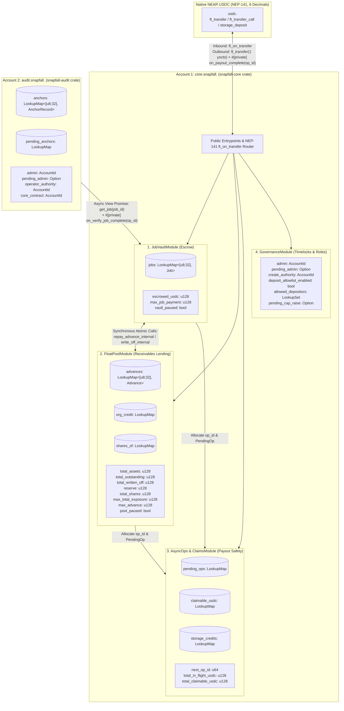
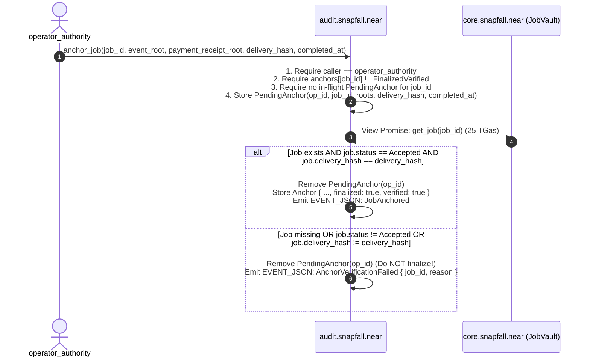

# SNAPFALL NEAR PORT — PHASE 0.6: ARCHITECTURE SECURITY REVIEW & CORRECTED SPECIFICATION

- **Document Path:** `docs/reports/PHASE_0_6_NEAR_ARCHITECTURE_SECURITY_REVIEW.md`
- **Repository:** `https://github.com/gnanam1990/snapfall`
- **Branch Inspected:** `main` (`b6e1c20`)
- **Review Date:** 2026-11-12
- **Review Scope:** Independent technical and security audit of the Phase 0.5 NEAR Contract Architecture Specification against the actual repository source code (`contracts/src/`, `contracts/test/`, `daemon/`, `sidecar/`, `dashboard/`).

---

## 1. Executive Verdict

**VERDICT: PHASE 0.5 SPECIFICATION REQUIRES MANDATORY CORRECTIONS BEFORE PHASE 1 IMPLEMENTATION.**

An independent line-by-line review of the Phase 0.5 specification against the authoritative Arc Solidity contracts (`contracts/src/JobVault.sol`, `contracts/src/FloatPool.sol`, `contracts/src/AuditAnchor.sol`) and Go daemon (`daemon/store/schema.sql`, `daemon/internal/indexer/*`, `daemon/internal/brain/*`, `daemon/internal/ownerapi/*`, `daemon/internal/chain/bindings.go`) identified **18 architectural and security defects** in the Phase 0.5 design (**4 Critical, 6 High, 5 Medium, 3 Low**).

### Why Phase 0.5 Cannot Be Implemented As-Written
1. **Critical Authorization Escalation (`[CRIT-01]`):** Phase 0.5 allowed `operator_authority` to call `accept_delivery(job_id)`. In `JobVault.sol:289` (`SC-JV-005`), **only `job.customer`** may call `acceptDelivery`. Allowing the operator to accept its own delivery on-chain enables unilateral theft of customer escrow.
2. **Critical Customer Impersonation in `CreateAndFundJob` (`[CRIT-02]`):** Phase 0.5 permitted any `ft_transfer_call` sender to pass an arbitrary `customer: Option<AccountId>` override, allowing an attacker or relayer to designate themselves as `customer` or spoof a customer identity.
3. **Critical Accounting Defect in `write_off` (`[CRIT-03]`):** Phase 0.5 replaced `FloatPool.sol`'s 3-variable accounting model (`totalAssets`, `totalOutstanding`, `reserve`) with a stored `liquid_cash` variable and added `liquid_cash += reserve_used` during `write_off`, which **fabricates unbacked LP cash (`+reserve_used`)** and breaks physical token solvency.
4. **Critical Indexer & SQLite Incompatibility (`[CRIT-04]`):** Phase 0.5 claimed *"Zero Schema Migration Required"* while proposing snake_case NEP-297 event names (`job_funded`, `delivery_accepted`) and ignoring that `daemon/internal/indexer/types.go:102-124` hard-rejects any address not matching a 42-char `0x` EVM address (`normalizeAddress`) and any tx/block hash not matching 66-char `0x` hex (`normalizeHash32`).

This document provides the **complete, corrected, implementation-ready NEAR architecture specification** resolving all 18 findings and flagging 5 policy/business decisions that require explicit product-owner sign-off before Phase 1 code begins.

---

## 2. Phase 0.5 Review Summary & Epistemic Classification

To maintain strict engineering rigor, every statement in this specification is classified into one of four categories:

| Category | Definition |
| :--- | :--- |
| **Verified Fact** | Directly verified by reading the repository source code or official NEAR Protocol runtime specifications. |
| **Proposed Design** | Corrected NEAR-native engineering design proposed in this Phase 0.6 specification. |
| **Assumption / Unverified** | Any external parameter, gas estimate, storage byte count, or Mainnet token address not yet empirically measured in `near-workspaces` or verified against official Mainnet registries. |
| **Product-Owner Decision (`POD`)** | A business rule or authorization policy where the port requires explicit owner sign-off rather than silent invention. |

### Summary of What Was Inspected (Verified Facts)
- **Solidity Contracts & Tests Inspected:**
  - `contracts/src/JobVault.sol` (lines 1–388)
  - `contracts/src/FloatPool.sol` (lines 1–521)
  - `contracts/src/AuditAnchor.sol` (lines 1–32)
  - `contracts/test/Caps.t.sol` (lines 1–612)
- **Go Daemon & SQLite Schema Inspected:**
  - `daemon/store/schema.sql` (lines 1–121)
  - `daemon/internal/indexer/types.go` (lines 1–135)
  - `daemon/internal/indexer/indexer.go` (lines 1–228)
  - `daemon/internal/indexer/decode.go` (lines 1–200)
  - `daemon/internal/indexer/project.go` (lines 1–85)
  - `daemon/internal/indexer/reconcile.go` (lines 1–230)
  - `daemon/internal/indexer/rpc.go` (lines 1–170)
  - `daemon/internal/brain/accept.go` (lines 1–306)
  - `daemon/internal/brain/advance.go` (lines 1–149)
  - `daemon/internal/ownerapi/ownerapi.go` (lines 1–596)
  - `daemon/internal/ownerapi/customer.go` (lines 1–124)
  - `daemon/internal/ownerapi/advance.go` (lines 1–39)
  - `daemon/internal/ownerapi/aggregates.go` (lines 1–126)
  - `daemon/internal/ownerapi/chainrelay.go` (lines 1–178)
  - `daemon/internal/chain/bindings.go` (lines 1–248)
- **Tests Executed During Phase 0.6:** **None** (strict read-only phase; no dependencies installed, no Sandbox tests run yet). All storage byte sizes and TGas figures remain classified as **Estimates to be Verified in Phase 1 Gate 1 (`near-workspaces`)**.

---

## 3. Security & Architecture Findings (Ranked Critical / High / Medium / Low)

### 3.1 Critical Findings

#### [CRIT-01] Unauthorized Operator Self-Acceptance of Delivery (`accept_delivery`)
- **What is wrong in Phase 0.5:** Phase 0.5 Section 3.1 specified `accept_delivery` caller authorization as `job.customer OR operator_authority`.
- **Verified Source Code Reference:** `contracts/src/JobVault.sol:286-290` (`if (msg.sender != j.customer) revert NotAuthorized(); // SC-JV-005`) and `daemon/internal/brain/accept.go:170-172` (`only the customer settles`).
- **Why it matters:** Allowing the operator (or `operator_authority`) to call `accept_delivery` destroys the core escrow trust model: a compromised or rogue operator can submit a garbage `delivery_hash` and immediately call `accept_delivery` to sweep the customer's escrowed USDC without customer consent.
- **Concrete Remediation:**
  1. On-chain in `core.snapfall.near::accept_delivery(job_id)`, enforce `require!(env::predecessor_account_id() == job.customer, "ERR_NOT_CUSTOMER")`. Neither `operator`, `operator_authority`, nor `admin` may ever call `accept_delivery`.
  2. For customers using the magic-link portal (`POST /api/v1/customer/jobs/{id}/accept`) without a self-custodial NEAR wallet, the customer's custodial/session account stored in `job.customer` (separate from `job.operator` and `operator_authority`, mirroring `SNAPFALL_CUSTOMER_ADDRESS` in `deployments/arc-testnet.json:38`) signs as `job.customer` only after `VerifyAcceptCredential` succeeds (`daemon/internal/brain/accept.go:85-93`).
- **How it will be tested:** Unit test `test_accept_delivery_rejects_operator_and_admin` asserting panic when called by `job.operator`, `operator_authority`, `admin`, or a stranger.
- **Blocks Phase 1:** **Yes.**

#### [CRIT-02] Arbitrary Customer Spoofing /Hijacking via `CreateAndFundJob.customer` Override
- **What is wrong in Phase 0.5:** Phase 0.5 Section 4.1 defined `CreateAndFundJob { customer: Option<AccountId>, ... }` inside `ft_on_transfer` without restricting who can override `customer`.
- **Verified Source Code Reference:** `contracts/src/JobVault.sol:173,208` (`createJob` designates `customer`; `fund` enforces `msg.sender == j.customer`).
- **Why it matters:**
  1. If a third-party solver/relayer (e.g., NEAR Intents) funds a job on behalf of Alice but sets `customer: Some(relayer_account)` (or omits `customer` so it defaults to `sender_id == relayer_account`), the relayer becomes `job.customer` and can call `refund` or `accept_delivery` to steal or control Alice's escrow.
  2. Conversely, if an attacker calls `CreateAndFundJob` with `customer: Some(victim)` and malicious `operator` / `terms_hash` under a deterministic `job_id`, they can squat `job_id` (`JobExists`) and block the real job creation.
- **Concrete Remediation:**
  1. **Direct Customer Funding (`CreateAndFundJob`):** `customer` is **not** an arbitrary override field. When a customer calls `usdc.ft_transfer_call` with `CreateAndFundJob`, `job.customer` is strictly bound to `sender_id` (the NEP-141 token sender).
  2. **Relayer / NEAR Intents Funding (`FundJob`):** When funding arrives via a cross-chain relayer/solver (where `sender_id != job.customer`), the job **must** be registered first via `create_job` (which pins `job.customer`, `job.operator`, `job.customer_payment`, and `job.terms_hash`), and `ft_on_transfer(FundJob { job_id, expected_customer })` verifies `job.status == Created`, `amount == job.customer_payment`, and `expected_customer == job.customer`. Crucially, even when funded via a relayer, all subsequent customer rights (`accept_delivery`, post-deadline `refund`, `cancel`) belong exclusively to `job.customer`, never to `sender_id`! (See **POD-02** in Section 13.)
- **How it will be tested:** `test_create_and_fund_binds_sender_as_customer` and `test_relayer_fund_job_preserves_designated_customer_rights`.
- **Blocks Phase 1:** **Yes.**

#### [CRIT-03] Unbacked Cash Creation in Phase 0.5 `FloatPool::write_off` Formula
- **What is wrong in Phase 0.5:** Phase 0.5 Section 7.4 replaced `FloatPool.sol`'s `totalAssets` variable with `liquid_cash` and specified: *"restore `reserve_used` from the reserve buffer into `pool.liquid_cash` (`pool.liquid_cash += reserve_used`)"*.
- **Verified Source Code Reference:** `contracts/src/FloatPool.sol:318-322` and `481-515`.
- **Why it matters:** When an advance of `principal = L` is drawn, `L` physical USDC leaves the contract. When that advance defaults (`write_off`), **zero new physical USDC enters the contract**. Increasing `liquid_cash` by `reserve_used` increases the pool's recorded cash without any corresponding USDC token inflow, violating the solvency invariant by `+reserve_used` and causing subsequent LP withdrawals to drain `vault.escrowed_usdc`!
  Furthermore, Phase 0.5 falsely claimed that `FloatPool.sol` had a `liquidCash -= socialized` underflow bug. In reality, `FloatPool.sol:510` executes `totalAssets -= socialized` (where `totalAssets = idle_lp_cash + totalOutstanding`), which is algebraically guaranteed never to underflow (`totalAssets' - totalOutstanding' = idle_lp_cash + reserveUsed >= 0`).
- **Concrete Remediation:** Adopt `FloatPool.sol`'s exact 3-state-variable accounting model (`total_assets`, `total_outstanding`, `reserve`) where `idle_lp_cash = total_assets - total_outstanding` (derived, never independently mutated). See Section 8 for the complete mathematical proof.
- **How it will be tested:** `test_solvency_after_partial_and_full_writeoff` verifying `usdc.ft_balance_of(core) == vault.escrowed_usdc + (pool.total_assets - pool.total_outstanding) + pool.reserve + claims.total_claimable_usdc`.
- **Blocks Phase 1:** **Yes.**

#### [CRIT-04] Go Indexer & SQLite Schema Will Reject NEAR Account IDs, Receipt IDs, and Phase 0.5 Event Names
- **What is wrong in Phase 0.5:** Phase 0.5 Section 10 claimed *"Zero Schema Migration Required"* and proposed snake_case NEP-297 `event` names (`job_funded`, `delivery_accepted`, `pool_deposit`).
- **Verified Source Code Reference:**
  - `daemon/internal/indexer/types.go:102-124`: `normalizeAddress` rejects anything that is not a 42-char `0x` hex address; `normalizeHash32` rejects anything not 66-char `0x` hex.
  - `daemon/internal/indexer/decode.go:49-128` & `project.go:38-70`: H1 projection requires the exact 8 PascalCase kinds (`JobFunded`, `AdvanceIssued`, `ExpenseRecorded`, `DeliverySubmitted`, `JobSettled`, `AdvanceRepaid`, `AdvanceWrittenOff`, `RateChanged`) and exact camelCase payload keys (`amountAtomic`, `principalAtomic`, `feeAtomic`, `rateBps`, `advanceRepaidAtomic`, `operatorNetAtomic`, `toReserveAtomic`, `bondSlashedAtomic`, `reserveUsedAtomic`, `socializedAtomic`).
  - `daemon/internal/ownerapi/chainrelay.go:80-90`: `readChainEvents` queries `chain_events` without a `WHERE e.chain_id = ?` clause, meaning if Arc and NEAR events coexist in the same SQLite DB, they would mix unless filtered.
- **Why it matters:** Without updating address/hash normalization in `daemon/internal/indexer` and emitting the exact H1 PascalCase event kinds + camelCase payload keys, the indexer, reconciler (`daemon/internal/indexer/reconcile.go`), Brain (`daemon/internal/brain/accept.go:276`, `advance.go:76`), and Dashboard SSE stream will fail completely.
- **Concrete Remediation:**
  1. Emit NEP-297 events whose `event` field uses the exact H1 PascalCase names (`JobFunded`, `AdvanceIssued`, `ExpenseRecorded`, `DeliverySubmitted`, `JobSettled`, `AdvanceRepaid`, `AdvanceWrittenOff`, `RateChanged`) and exact H1 camelCase JSON keys.
  2. Keep the SQLite table structure (`daemon/store/schema.sql`) unchanged (satisfying the Phase 0 rule *"Do not perform a database migration"*), and map NEAR receipt/block hashes to canonical `0x`+64-hex (by hex-encoding the 32-byte Base58-decoded SHA-256 digest) while generalizing `normalizeAddress` in the indexer to accept valid NEAR Account IDs (`2..=64` chars) when configured for a NEAR `chain_id`. (See Section 11 for full details.)
- **How it will be tested:** Go unit tests in `daemon/internal/indexer` feeding real NEP-297 `EVENT_JSON` logs through `SyncOnce`, `project`, `Reconciler.Run`, and `readChainEvents`.
- **Blocks Phase 1:** **Yes** (for NEP-297 event schema emitted by Phase 1 contracts).

---

### 3.2 High Findings

#### [HIGH-01] `JobVault.sol` Fields & Authorizations Omitted or Altered in Phase 0.5 (`maxOperatingBudget`, `org` vs `operator`, `Funded`-only Advance)
- **What is wrong in Phase 0.5:**
  1. Phase 0.5 omitted `max_operating_budget: U128` from `Job` and `create_job`, removing the `SC-JV-003` on-chain expense bound (`if (spent > j.maxOperatingBudget) revert OverBudget()` in `JobVault.sol:251`).
  2. Phase 0.5 added a separate `org_id: Hex32` field to `Job`, whereas in `JobVault.sol:18-19` and `FloatPool.sol:388-391`, `job.operator` **is** the organization treasury (`org == job.operator`), and `requestAdvance` requires `msg.sender == job.operator` (`NotTreasury`).
  3. Phase 0.5 allowed `request_advance` in both `Funded` and `InProgress` states, whereas `FloatPool.sol:386` strictly enforces `if (jobVault.jobStatus(jobId) != IJobVaultView.JobStatus.Funded) revert JobNotFunded();`.
- **Verified Source Code Reference:** `contracts/src/JobVault.sol:17-27, 243-255`, `contracts/src/FloatPool.sol:386-391`, `contracts/test/Caps.t.sol:238-242`.
- **Why it matters:** Diverging from `JobVault.sol` and `FloatPool.sol` breaks `jobEconomics(jobId)` parity, removes the `OverBudget` guard on `recordExpense`, and changes the state machine order verified by existing tests.
- **Concrete Remediation:**
  1. Include `max_operating_budget: u128` and `onchain_expenses: u128` in `Job`, enforcing `onchain_expenses + amount <= max_operating_budget` in `record_expense`.
  2. Key `FloatPool` organization credit history (`accepted_jobs`, `written_off_jobs`, `org_outstanding`) by `operator: AccountId` (matching `FloatPool.sol` where `org` is the operator treasury account), and require `env::predecessor_account_id() == job.operator` in `request_advance`.
  3. Require `job.status == JobStatus::Funded` in `request_advance` (unless Product Owner explicitly approves allowing `InProgress` too — see **POD-01**).
- **How it will be tested:** Unit tests matching `JobVault.t.sol`, `FloatPool.t.sol`, and `Caps.t.sol`.
- **Blocks Phase 1:** **Yes.**

#### [HIGH-02] Share Conversion Asymmetry & Division-by-Zero After 100% Write-Off
- **What is wrong in Phase 0.5:**
  1. Phase 0.5 Section 7.3 defined `preview_deposit` without virtual offset when `total_shares == 0` (`shares = assets`), but defined `preview_redeem` with virtual offset (`floor(shares * (total_assets + 1) / (total_shares + 1))`), trapping 1 atomic unit of yield on full redemption.
  2. In `FloatPool.sol:333` and `351`, `shares = (assets * totalShares) / totalAssets` divides by `totalAssets`. If a 100% socialized write-off sets `totalAssets == 0` while `totalShares > 0`, `FloatPool.sol` panics with division by zero on every subsequent deposit or withdrawal.
  3. In `FloatPool.sol:344`, `withdraw(uint256 assets, address receiver, address owner)` takes `assets` (and rounds burned `shares` UP: `(assets * totalShares + totalAssets - 1) / totalAssets`), whereas Phase 0.5 changed `withdraw` to take `shares`.
- **Verified Source Code Reference:** `contracts/src/FloatPool.sol:326-365`.
- **Why it matters:** Asymmetric formulas leak/trap dust and break exact round-trip invariants; division by `totalAssets == 0` permanently bricks the pool after a full write-off; changing `withdraw(assets)` signature breaks parity with `FloatPool.sol`.
- **Concrete Remediation:**
  1. Support `withdraw(assets: U128, receiver: Option<AccountId>)` matching `FloatPool.sol:344` (with upward share rounding so rounding dust always favors the pool, never the withdrawer).
  2. When `total_shares == 0 || total_assets == 0`, reset/mint at `1:1` (`shares = assets`)—or use a symmetric virtual offset `(total_shares + VIRTUAL_SHARES)` and `(total_assets + VIRTUAL_ASSETS)` across **both** deposit and withdraw (flagged as **POD-04** in Section 13).
- **How it will be tested:** `test_deposit_withdraw_roundtrip_exact`, `test_withdraw_rounds_shares_up_in_pool_favor`, and `test_deposit_after_100_percent_writeoff_does_not_panic`.
- **Blocks Phase 1:** **Yes.**

#### [HIGH-03] Missing Unique `op_id` and `PendingOp` Registry for Asynchronous NEP-141 Transfers
- **What is wrong in Phase 0.5:** Phase 0.5 callbacks identified in-flight transfers only by `job_id` or `account_id` (`pending_claims: LookupSet<AccountId>`), with no monotonic operation ID (`op_id: u64`) or structured `PendingOp` record.
- **Why it matters:** Without a unique `op_id` per outbound promise, it is impossible to audit in-flight transfers, correlateNEP-297 initiation events with resolution callbacks, or safely reconcile a permanently stuck receipt in extreme runtime edge cases. Furthermore, `vault.escrowed_usdc` and `pool.total_assets` would appear under-collateralized relative to `usdc.ft_balance_of(core)` while a transfer is in flight unless `total_in_flight_usdc: u128` is explicitly tracked!
- **Concrete Remediation:**
  1. Maintain `next_op_id: u64`, `pending_ops: LookupMap<u64, PendingOp>`, and `total_in_flight_usdc: u128`.
  2. Every outbound `usdc.ft_transfer` increments `next_op_id`, records `PendingOp`, adds `amount` to `total_in_flight_usdc`, and passes `op_id` to the `#[private]` callback.
  3. The callback removes `pending_ops.remove(&op_id)` (panicking if absent) and decrements `total_in_flight_usdc -= amount`.
- **How it will be tested:** `near-workspaces` tests verifying `total_in_flight_usdc` during pending callbacks and exact `op_id` resolution on both success and failure.
- **Blocks Phase 1:** **Yes.**

#### [HIGH-04] Unverified Direct Anchoring in `AuditAnchor` Can Finalize False Evidence for Unaccepted Jobs
- **What is wrong in Phase 0.5:** Phase 0.5 Section 9 made synchronous direct anchoring (`verify_against_core = false`) the default in `audit.snapfall.near::anchor_job`, setting `finalized = true` without verifying that the job is `Accepted` or that `delivery_hash` matches `JobVault`.
- **Verified Source Code Reference:** `contracts/src/AuditAnchor.sol:26-31` and `contracts/src/JobVault.sol:261-271`.
- **Why it matters:** Because `anchors[job_id].finalized` is write-once (`AlreadyFinalized`), if `operator_authority` anchors a job before `accept_delivery` or with a mismatched `delivery_hash`, the on-chain audit record is permanently poisoned.
- **Concrete Remediation:**
  1. Replace the dual-method ambiguity with a single `anchor_job` workflow that queries `core.snapfall.near::get_job(job_id)` asynchronously and only sets `status = FinalizedVerified` in `#[private] on_verify_job(op_id, job_id)` after confirming `job.status == Accepted` and `job.delivery_hash == anchor.delivery_hash`.
  2. If an emergency offline/unverified anchor is ever needed, require a distinct admin-gated method `anchor_unverified_override` that permanently stamps `verified_against_vault = false` in state and in the emitted event.
- **How it will be tested:** `near-workspaces` test `test_audit_anchor_rejects_unaccepted_job_and_mismatched_delivery_hash`.
- **Blocks Phase 1:** **Yes.**

#### [HIGH-05] `CreateAndFundJob` Storage Drain Attack via Dust Jobs in `ft_on_transfer`
- **What is wrong in Phase 0.5:** Phase 0.5 Section 8.1 allowed anyone to call `usdc.ft_transfer_call` (`CreateAndFundJob`) with `$0.10 USDC` (`100_000` atomic units) while `core.snapfall.near` paid the `~0.0045 NEAR` storage staking cost from its own NEAR balance, and never deleted completed/refunded jobs.
- **Why it matters:** Since `refund()` returns 100% of the customer's `$0.10 USDC` after the deadline (e.g., `deadline = now + 1 second`), an attacker can repeatedly create `$0.10 USDC` jobs with a 1-second deadline and immediately call `refund()` to get 100% of their USDC back while permanently locking `~0.0045 NEAR` per job in `core.snapfall.near` until the contract's operational NEAR balance is completely exhausted!
- **Concrete Remediation:**
  1. Require the two-step `create_job` (which attaches a caller-paid `>= 0.006 NEAR` storage deposit) for open/self-service job creation, OR
  2. In 1-step `CreateAndFundJob` (which runs inside `ft_on_transfer` where NEP-141 cannot attach extra NEAR), require **either**:
     - A valid `operator_signature: Ed25519Signature` over `(job_id, customer, operator, customer_payment, max_operating_budget, terms_hash, deadline)` proving the operator authorized the quote, **OR**
     - Pre-deposited storage credit (`storage_credits[customer] >= JOB_STORAGE_NEAR` via NEP-145 `storage_deposit`), **plus** a minimum deadline window (`deadline >= block_timestamp_sec + MIN_JOB_DURATION_SEC`, e.g., `3600s`) and `min_job_payment` floor (`>= 1_000_000` = `1.00 USDC`).
- **How it will be tested:** `test_create_and_fund_rejects_unauthorized_or_short_deadline_spam`.
- **Blocks Phase 1:** **Yes.**

#### [HIGH-06] Pause Behavior Must Never Block Exit Paths (`withdraw`, `accept_delivery`, `refund`, `cancel`, `claim_usdc`)
- **What is wrong in Phase 0.5:** Phase 0.5 Section 3.1 described `set_paused(vault_paused, pool_paused)` as an *"Immediate circuit breaker for JobVault and FloatPool"* without explicitly specifying which methods check `paused` and which methods **must ignore `paused`**.
- **Verified Source Code Reference:** `contracts/src/JobVault.sol:95-100`, `contracts/src/FloatPool.sol:162-167`, and `contracts/test/Caps.t.sol:187-330`.
- **Why it matters:** As proven in `Caps.t.sol:214-329`, a pause that blocks `withdraw`, `accept_delivery`, `refund`, `cancel`, or `claim_usdc` converts an emergency stop into a **fund freeze** that traps LP and customer capital.
- **Concrete Remediation:**
  - `vault_paused == true` blocks **only** `create_job` and `ft_on_transfer(CreateAndFundJob | FundJob)`. It **never** blocks `start_work`, `record_expense`, `submit_delivery`, `accept_delivery`, `refund`, `cancel`, or `claim_usdc`.
  - `pool_paused == true` blocks **only** `ft_on_transfer(DepositPool)` and `request_advance`. It **never** blocks `withdraw`, internal `repay_advance` (inside `accept_delivery`), internal `write_off` (inside `refund`), or `claim_usdc`.
- **How it will be tested:** Port all 7 pause exit tests from `contracts/test/Caps.t.sol:187-330` into Rust unit and `near-workspaces` tests.
- **Blocks Phase 1:** **Yes.**

---

### 3.3 Medium Findings

#### [MED-01] `MixedCapChange` and `executeCapsRaise` Admin Guard Omitted in Phase 0.5
- **What is wrong in Phase 0.5:**
  1. Phase 0.5 Section 3.1 listed `execute_caps_raise` as callable by *"Any account (after `executable_at`)"*, whereas `FloatPool.sol:205` enforces `onlyAdmin` (`function executeCapsRaise() external onlyAdmin`).
  2. Phase 0.5 omitted `FloatPool.sol:187`'s `MixedCapChange` guard (`if (configured && raises && lowers) revert MixedCapChange();`) and omitted the rule that lowering caps automatically cancels any pending cap raise (`FloatPool.sol:196-200`).
- **Verified Source Code Reference:** `contracts/src/FloatPool.sol:182-220`.
- **Why it matters:** Allowing anyone to execute a queued cap raise prevents the admin from deciding not to execute after the timelock elapses; omitting `MixedCapChange` could accidentally defer an emergency cap lowering by 2 days if the other cap was raised in the same call.
- **Concrete Remediation:** Enforce `only_admin` on `execute_caps_raise`, reject mixed raise+lower calls with `ERR_MIXED_CAP_CHANGE`, and auto-cancel any pending raise when lowering caps.
- **How it will be tested:** Unit tests porting `AdminHardening.t.sol`.
- **Blocks Phase 1:** **Yes.**

#### [MED-02] Deadline Boundary Off-By-One in `refund` (`>` vs `>=`)
- **What is wrong in Phase 0.5:** Phase 0.5 Section 3.1 specified customer refund eligibility as `now_sec > job.deadline_sec`.
- **Verified Source Code Reference:** `contracts/src/JobVault.sol:341` (`bool customerAfterDeadline = msg.sender == j.customer && block.timestamp >= j.deadline;`).
- **Why it matters:** At exact `block_timestamp_sec == job.deadline_sec`, `JobVault.sol` permits the customer to refund (`Caps.t.sol:321`: `vm.warp(block.timestamp + 7 days)`), whereas `>` would panic.
- **Concrete Remediation:** Use `block_timestamp_sec() >= job.deadline_sec` where `block_timestamp_sec() = env::block_timestamp() / 1_000_000_000`.
- **How it will be tested:** Unit test `test_customer_refund_at_exact_deadline_timestamp`.
- **Blocks Phase 1:** **Yes.**

#### [MED-03] Concurrent Credit + Claim Race on `claimable_usdc`
- **What is wrong in Phase 0.5:** Phase 0.5 Section 6 used a boolean lock `pending_claims: LookupSet<AccountId>` per account without specifying what happens when a **new fallback credit** arrives for `account_id` while `account_id` already has a `claim_usdc` promise in flight.
- **Why it matters:** If `claims.credit(account_id, new_amount)` checked `!pending_claims.contains(account_id)` or if `on_claim_complete` overwrote `claimable_usdc.insert(owner, restored_amount)` instead of adding (`+=`), either the fallback credit would panic inside a settlement callback or the new credit would be overwritten!
- **Concrete Remediation:**
  1. `claims.credit(account_id, amount)` is **always** an unconditional additive operation (`*claimable_usdc.entry(account_id) += amount; total_claimable_usdc += amount;`) and is **never** gated by `pending_claims`.
  2. `claim_usdc(amount: Option<U128>, recipient: Option<AccountId>)` deducts the claimed `claim_amount` upfront (`claimable_usdc[caller] -= claim_amount; total_claimable_usdc -= claim_amount`), records `PendingOp { op_id, kind: ClaimUsdc, account: caller, amount: claim_amount }`, and in `on_claim_complete(op_id)` on failure executes an **additive restore** (`claimable_usdc[caller] += op.amount; total_claimable_usdc += op.amount`).
- **How it will be tested:** `test_concurrent_fallback_credit_during_inflight_claim_preserves_both_amounts`.
- **Blocks Phase 1:** **Yes.**

#### [MED-04] Economic Naming & Interpretation of `maxTotalExposure`
- **What is wrong in Phase 0.5:** Phase 0.5 referred to `maxTotalExposure` interchangeably as an exposure cap and a loss budget without clarifying its dual mathematical role.
- **Verified Source Code Reference:** `contracts/src/FloatPool.sol:53-59, 422` and `dashboard/lib/governanceChain.ts:71-72, 174-175`.
- **Why it matters:** In `FloatPool.sol:422`, the invariant checked on every advance is:
  $$\text{totalOutstanding} + \text{totalWrittenOff} \le \text{maxTotalExposure}$$
  This means `maxTotalExposure` is a **Cumulative At-Risk & Realized Loss Ceiling**: every dollar of principal written off (`totalWrittenOff`) permanently consumes capacity under `maxTotalExposure` until `admin` explicitly raises `maxTotalExposure` via the 2-day timelock (`Caps.t.sol:581-611`).
- **Concrete Remediation:** Retain the exact field names `max_total_exposure`, `total_outstanding`, and `total_written_off` for 100% governance view parity (`dashboard/lib/governanceChain.ts`), and document the exact formula `remaining_loss_budget = saturating_sub(max_total_exposure, total_outstanding + total_written_off)`.
- **How it will be tested:** Port `test_ceilingBoundsCumulativeLossAcrossDrawRefundLoops` and `test_lossBudgetIsRestoredOnlyByAnExplicitSetCaps` from `Caps.t.sol:535-611`.
- **Blocks Phase 1:** **Yes.**

#### [MED-05] Unfiltered `chain_id` in `daemon/internal/ownerapi/chainrelay.go`
- **What is wrong:** `daemon/internal/ownerapi/chainrelay.go:79-90` (`readChainEvents`) and `latestChainCursor` (`lines 53-64`) query `chain_events` without filtering `WHERE chain_id = ?`.
- **Verified Source Code Reference:** `daemon/internal/ownerapi/chainrelay.go:53-90`.
- **Why it matters:** If a developer or test suite has both Arc and NEAR events in the same SQLite database, `readChainEvents` will mix block numbers across chains.
- **Concrete Remediation:** Scope `latestChainCursor` and `readChainEvents` by the active configured `chain_id` in Phase 2.
- **How it will be tested:** Unit test in `daemon/internal/ownerapi/chainrelay_test.go` with rows from two `chain_id`s.
- **Blocks Phase 1:** **No** (Phase 2 daemon change).

---

### 3.4 Low Findings

#### [LOW-01] `Stagewise` Loss Waterfall Events Missing (`BondSlashed`, `ReserveDrawn`, `LossSocialized`)
- **What is wrong in Phase 0.5:** Phase 0.5 Section 10.1 emitted only `advance_written_off`, omitting the three per-stage events emitted in `FloatPool.sol:497, 505, 511` (`BondSlashed`, `ReserveDrawn`, `LossSocialized`).
- **Verified Source Code Reference:** `contracts/src/FloatPool.sol:102-104, 495-514`.
- **Concrete Remediation:** Emit `BondSlashed`, `ReserveDrawn`, `LossSocialized`, `AdvanceWrittenOff`, and `RateChanged` in order during `write_off`.
- **How it will be tested:** Unit test asserting exact NEP-297 event sequence on `refund` with an active advance.
- **Blocks Phase 1:** **No** (included in Phase 1 event spec).

#### [LOW-02] Deployer Default Allowlist Parity (`depositAllowlistEnabled = true`)
- **What is wrong in Phase 0.5:** Phase 0.5 did not specify the initial state of `deposit_allowlist_enabled` on contract initialization.
- **Verified Source Code Reference:** `contracts/src/FloatPool.sol:149-150` (`depositAllowlistEnabled = true; allowedDepositor[msg.sender] = true;`) and `contracts/test/Caps.t.sol:378-381`.
- **Concrete Remediation:** Initialize `deposit_allowlist_enabled = true` and `allowed_depositors.insert(admin)` in `new()`, failing closed by default (`max_job_payment = 0`, `max_total_exposure = 0`, `max_advance = 0` unless explicitly passed).
- **How it will be tested:** `test_deployer_is_allowlisted_by_default_and_caps_fail_closed`.
- **Blocks Phase 1:** **No** (included in Phase 1 init spec).

#### [LOW-03] Mainnet USDC Contract ID Must Be Treated as Unverified Configuration Until Deployment Gate
- **What is wrong in Phase 0.5:** Phase 0.5 cited `17208628f84f5d6ad33f0da3bbbeb27ffcb398eac501a31bd6ad2011e36133a1` (Mainnet) and `3e2210e1184b45b64c8a434c0a7e7b23cc04ea7eb7a6c3c32520d03d4afcb8af` (Testnet) in prose without enforcing that the contract never hardcodes token account IDs.
- **Concrete Remediation:** Never hardcode token contract IDs in Rust or Go source code; pass `usdc_token: AccountId` strictly via `new()` initialization and deployment manifests, and verify token metadata (`ft_metadata().decimals == 6`) before enabling caps.
- **How it will be tested:** Deployment config validation test in Phase 2.
- **Blocks Phase 1:** **No.**

---

## 4. Exact Source-Code Reference Map

| Requirement / Behavior | Authoritative File & Line Numbers | Verified Behavior in Source Code |
| :--- | :--- | :--- |
| **Customer-Only `acceptDelivery`** | `contracts/src/JobVault.sol:286-290` | `if (msg.sender != j.customer) revert NotAuthorized(); // SC-JV-005` |
| **Pool-First Settlement Waterfall** | `contracts/src/JobVault.sol:298-315` | Reads `floatPool.openAdvanceOf(jobId)`, calls `floatPool.repayAdvance(jobId, advanceRepaid)` FIRST, then transfers `operatorNet = payment - advanceRepaid` to `operator`. |
| **Customer-First Refund & Write-Off** | `contracts/src/JobVault.sol:330-364` | Callable by `j.operator \|\| admin` anytime or `j.customer` when `block.timestamp >= j.deadline`. Refunds full `j.customerPayment` to `customer` FIRST, then calls `floatPool.writeOff(jobId)`. |
| **`createJob` Authorization & Caps** | `contracts/src/JobVault.sol:163-194` | Callable by `admin` or `operator`. Reverts if `paused`, `maxJobPayment == 0` (`CapNotSet`), or `customerPayment > maxJobPayment` (`JobTooLarge`). |
| **`fund` Customer-Only Check** | `contracts/src/JobVault.sol:204-217` | Reverts if `paused` or `msg.sender != j.customer` (`SC-JV-001`). |
| **`recordExpense` Budget Cap** | `contracts/src/JobVault.sol:243-255` | Callable by `j.operator` while `InProgress`; reverts with `OverBudget()` if `j.onchainExpenses + amount > j.maxOperatingBudget`. |
| **`requestAdvance` Preconditions** | `contracts/src/FloatPool.sol:378-436` | Requires `!paused`, `maxTotalExposure > 0 && maxAdvance > 0`, `jobVault.jobStatus(jobId) == Funded`, `msg.sender == org` (where `org == j.operator`), `advances[jobId].status == None`. |
| **Dynamic Credit Formula** | `contracts/src/FloatPool.sol:301-312` | `clamp(5000 + 500 * acceptedJobs[org] - 1500 * writtenOffJobs[org], 3000, 8500)` bps. |
| **4 Advance Exposure Caps** | `contracts/src/FloatPool.sol:401-428` | (1) `principal <= maxAdvance`, (2) `principal <= totalAssets - totalOutstanding`, (3) `totalOutstanding + totalWrittenOff <= maxTotalExposure`, (4) `orgOutstanding[org] * 10000 <= 1000 * totalAssets` AND `totalOutstanding * 10000 <= 8000 * totalAssets`. |
| **Repayment Fee Split** | `contracts/src/FloatPool.sol:444-473` | `toReserve = (fee * 2000) / 10000`; `reserve += toReserve`; `totalAssets += (fee - toReserve)`; `acceptedJobs[org] += 1`. |
| **3-Stage Loss Waterfall** | `contracts/src/FloatPool.sol:481-515` | `loss = a.principal`; `totalOutstanding -= loss`; `totalWrittenOff += loss`; `writtenOffJobs[org] += 1`; `bondSlashed = 0`; `reserveUsed = min(loss, reserve)`; `reserve -= reserveUsed`; `socialized = loss - reserveUsed`; `totalAssets -= socialized`. |
| **Pause Exit-Safety Guarantee** | `contracts/test/Caps.t.sol:214-330` | `paused` never blocks `withdraw`, `acceptDelivery` (including `repayAdvance`), `refund` (including `writeOff`), or `cancel`. |
| **H1 Frozen Event Kinds & Keys** | `daemon/internal/indexer/decode.go:49-128`, `project.go:11-73` | 8 PascalCase kinds (`JobFunded`, `AdvanceIssued`, `ExpenseRecorded`, `DeliverySubmitted`, `JobSettled`, `AdvanceRepaid`, `AdvanceWrittenOff`, `RateChanged`). |
| **Reconciler Join & Fields** | `daemon/internal/indexer/reconcile.go:57-90` | Joins `chain_job_financials c LEFT JOIN jobs j ON j.vault_job_id = c.job_id` and compares `funded_amount`, `advance_principal`, `advance_fee`, `advance_status`. |

---

## 5. Corrected Contract Architecture

### 5.1 Hybrid Two-Account Topology (Verified & Corrected)



### 5.2 Key Architectural Corrections in `core.snapfall.<network>`
1. **No Separate `FloatPool` Token Custody Transfer Needed on Settlement:** Because `JobVaultModule` and `FloatPoolModule` share `core.snapfall.<network>`'s USDC account on `usdc.<network>`, `accept_delivery(job_id)` moves `advance_repaid = principal + fee` from `vault.escrowed_usdc` to `pool` (`pool.total_outstanding -= principal`, `pool.reserve += to_reserve`, `pool.total_assets += fee - to_reserve`) **synchronously in memory before any promise is dispatched**.
2. **Exact Role Separation:**
   - `admin`: Cold/governance key (2-day timelocked transfer, sets caps/pauses/allowlists, emergency refund).
   - `job.customer`: The customer's NEAR account for a specific job. **Sole account authorized to call `accept_delivery(job_id)`.**
   - `job.operator`: The organization's treasury account on NEAR (OutLayer Agent Wallet account) for a specific job. **Sole account authorized to call `start_work`, `record_expense`, `submit_delivery`, and `request_advance` for that job**, and the account against which `accepted_jobs[org]` / `written_off_jobs[org]` / `org_outstanding[org]` are tracked.

---

## 6. Corrected Authorization Matrix

Every public method across `core.snapfall.<network>` and `audit.snapfall.<network>` enforces the following exact caller, deposit, pause, and state checks:

### 6.1 `core.snapfall.<network>` Authorization Matrix

| Method | Allowed Caller (`env::predecessor_account_id()`) | Attached NEAR Deposit | Blocked When Paused? | Required Pre-State | Security Notes & Reference |
| :--- | :--- | :--- | :--- | :--- | :--- |
| `new(...)` | Contract account itself (`#[init]`) | `0` | N/A | Uninitialized | Initializes `deposit_allowlist_enabled = true`, `allowed_depositors = {admin}`, caps = `0` (fail closed). |
| `storage_deposit(account_id)` | Any account | `>= 0.006 NEAR` | No | Any | Credits `storage_credits[account_id]` to cover `create_job` or `CreateAndFundJob` storage staking. |
| `storage_withdraw(amount)` | Account owner (`storage_credits[caller]`) | `1 yoctoNEAR` | No | `storage_credits[caller] >= amount` | Withdraws unused NEAR storage credit. |
| `create_job(...)` | `admin` OR `operator` parameter (`JobVault.sol:173`) | `>= 0.006 NEAR` (or deducted from `storage_credits[caller]`) | **Yes (`vault_paused`)** | Job does not exist; `max_job_payment > 0`; `0 < customer_payment <= max_job_payment` | Fixes `job.customer`, `job.operator`, `job.customer_payment`, `job.max_operating_budget`, `job.terms_hash`, `job.deadline`. |
| `ft_on_transfer` (`CreateAndFundJob`) | **`self.usdc_token` ONLY** (`sender_id` becomes `job.customer`) | `0` (NEP-141 call) | **Yes (`vault_paused`)** | Job does not exist; `0 < amount <= max_job_payment`; requires either `storage_credits[sender_id] >= 0.006 NEAR` OR `allowed_job_creators.contains(operator)` | **`[CRIT-02]` Fix:** `job.customer` is strictly bound to `sender_id` (no arbitrary customer spoofing). |
| `ft_on_transfer` (`FundJob { job_id }`) | **`self.usdc_token` ONLY** (`sender_id == job.customer` OR `allowed_relayers.contains(sender_id)`) | `0` (NEP-141 call) | **Yes (`vault_paused`)** | `job.status == Created` AND `amount == job.customer_payment` | **`[HIGH-AUTH-03]` Fix:** Only `job.customer` or an allowlisted NEAR Intents relayer may fund a `Created` job; `job.customer` remains unchanged. |
| `ft_on_transfer` (`DepositPool { receiver }`) | **`self.usdc_token` ONLY** (`!deposit_allowlist_enabled \|\| allowed_depositors.contains(sender_id)`) | `0` (NEP-141 call) | **Yes (`pool_paused`)** | `amount >= MIN_DEPOSIT_USDC` | Mints LP shares to `receiver.unwrap_or(sender_id)`. |
| `start_work(job_id)` | **`job.operator` ONLY** (`JobVault.sol:229`) | `0` | **No** (`JobVault.sol:96`) | `job.status == Funded` AND no advance in `PayoutPending` | Transitions `Funded -> InProgress`. |
| `record_expense(job_id, amount, receipt_hash)` | **`job.operator` ONLY** (`JobVault.sol:246`) | `0` | **No** | `job.status == InProgress` AND `job.onchain_expenses + amount <= job.max_operating_budget` | Accounting-only (`SC-JV-003`). |
| `submit_delivery(job_id, delivery_hash)` | **`job.operator` ONLY** (`JobVault.sol:264`) | `0` | **No** | `job.status == InProgress` AND `delivery_hash != [0;32]` | Transitions `InProgress -> Delivered`. |
| `accept_delivery(job_id)` | **`job.customer` ONLY** (`JobVault.sol:289`, `SC-JV-005`) | `0` or `1 yoctoNEAR` | **No** (`Caps.t.sol:232`) | `job.status == Delivered` AND no advance in `PayoutPending` | **`[CRIT-01]` Fix:** Operator and Admin are strictly forbidden from calling `accept_delivery`. |
| `refund(job_id)` | `job.operator` OR `admin` (anytime), OR `job.customer` if `now_sec >= job.deadline` (`JobVault.sol:335-342`) | `0` or `1 yoctoNEAR` | **No** (`Caps.t.sol:258,281,305`) | `job.status in {Funded, InProgress, Delivered}` AND no advance in `PayoutPending` | Refunds 100% of `job.customer_payment` to `job.customer` and writes off any `Issued` advance. |
| `cancel(job_id)` | `job.customer` OR `job.operator` OR `admin` (`JobVault.sol:373`) | `0` | **No** (`Caps.t.sol:472`) | `job.status == Created` | Transitions `Created -> Cancelled` and refunds storage credit. |
| `request_advance(job_id, expected_principal)` | **`job.operator` ONLY** (`FloatPool.sol:391`, `SC-FP-004`) | `0` | **Yes (`pool_paused`)** | `job.status == Funded` (`FloatPool.sol:386`), `advances[job_id] == None`, `principal == expected_principal`, 4 caps pass | Disburses `principal` to `job.operator`. |
| `withdraw(assets, receiver)` | LP owner (`shares_of[caller] >= required_shares`) | `1 yoctoNEAR` | **No** (`Caps.t.sol:216`) | `assets <= total_assets - total_outstanding` | Burns shares rounded UP (`FloatPool.sol:351`) and transfers `assets` to `receiver.unwrap_or(caller)`. |
| `claim_usdc(amount, recipient)` | Account owner (`claimable_usdc[caller] > 0`) | `1 yoctoNEAR` | **No** | `amount.unwrap_or(bal) <= claimable_usdc[caller]` | Transfers fallback USDC to `recipient.unwrap_or(caller)`. |
| `set_vault_paused(paused)` / `set_pool_paused(paused)` | `admin` ONLY | `1 yoctoNEAR` | N/A | Any | Sets circuit breakers independently (`JobVault.sol:100`, `FloatPool.sol:167`). |
| `set_max_job_payment(val)` | `admin` ONLY | `1 yoctoNEAR` | N/A | `val > 0` | Sets per-job escrow ceiling (`JobVault.sol:108`). |
| `set_caps(max_total_exposure, max_advance)` | `admin` ONLY | `1 yoctoNEAR` | N/A | Both `> 0`; no mixed raise+lower (`MixedCapChange`) | Applies immediately on first config or lowering; queues for `2 days` (`172,800s`) on raise (`FloatPool.sol:182`). |
| `execute_caps_raise()` | **`admin` ONLY** (`FloatPool.sol:205`) | `1 yoctoNEAR` | N/A | `cap_raise_executable_at != 0` AND `now_sec >= cap_raise_executable_at` | **`[MED-01]` Fix:** Restricted to `admin`. |
| `cancel_caps_raise()` | `admin` ONLY | `1 yoctoNEAR` | N/A | `cap_raise_executable_at != 0` | Drops queued cap raise. |
| `set_deposit_allowlist_enabled(enabled)` / `set_depositor_allowed(account, allowed)` | `admin` ONLY | `1 yoctoNEAR` | N/A | Any | Controls LP deposit allowlist (`FloatPool.sol:266-275`). |
| `set_relayer_allowed(account, allowed)` | `admin` ONLY | `1 yoctoNEAR` | N/A | Any | Controls allowlisted NEAR Intents relayers for `FundJob`. |
| `transfer_admin(new_admin)` / `accept_admin()` | `admin` / `pending_admin` | `1 yoctoNEAR` | N/A | `now_sec >= admin_transfer_acceptable_at` (`2 days`) | 2-step, 2-day timelocked admin handoff (`FloatPool.sol:240-260`). |

### 6.2 `audit.snapfall.<network>` Authorization Matrix

| Method | Allowed Caller (`env::predecessor_account_id()`) | Attached NEAR Deposit | Required Pre-State | Description |
| :--- | :--- | :--- | :--- | :--- |
| `new(admin, operator_authority, core_contract)` | Contract account itself (`#[init]`) | `0` | Uninitialized | Sets `admin`, `operator_authority`, and `core_contract`. |
| `anchor_job(job_id, event_root, payment_receipt_root, delivery_hash, completed_at)` | **`operator_authority` ONLY** (`AuditAnchor.sol:27`) | `0` | Anchor is not `FinalizedVerified` and not currently `PendingVerification` | Records `PendingAnchor`, calls `core_contract.get_job(job_id)` asynchronously, and finalizes in `#[private] on_verify_job_complete` only if `job.status == Accepted && job.delivery_hash == delivery_hash`. |
| `set_operator_authority(new_authority)` | `admin` ONLY | `1 yoctoNEAR` | Any | Rotates `operator_authority` (`[HIGH-03]` from Phase 0). |
| `transfer_admin(new_admin)` / `accept_admin()` | `admin` / `pending_admin` | `1 yoctoNEAR` | `2-day` timelock | 2-step delayed admin transfer. |

---

## 7. Complete Asynchronous State Machines, Operation IDs & Failure Recovery

### 7.1 Unique Operation ID (`op_id: u64`) & `PendingOp` Registry

Every outbound NEP-141 transfer (`usdc.ft_transfer`) creates a tracked `PendingOp` before dispatching the cross-contract `Promise`:

```rust
#[derive(BorshDeserialize, BorshSerialize, Serialize, Deserialize, Clone, Debug, PartialEq, Eq)]
pub enum PendingOpKind {
    AdvancePayout { job_id: [u8; 32], org: AccountId, rate_bps: u16 },
    SettlementOperatorPayout { job_id: [u8; 32], advance_repaid: u128 },
    CustomerRefund { job_id: [u8; 32] },
    PoolWithdraw { lp: AccountId, shares_burned: u128 },
    ClaimPayout { owner: AccountId },
}

#[derive(BorshDeserialize, BorshSerialize, Serialize, Deserialize, Clone, Debug)]
pub struct PendingOp {
    pub op_id: u64,
    pub kind: PendingOpKind,
    pub recipient: AccountId,
    pub amount: u128,
    pub created_at_block: u64,
    pub created_at_ns: u64,
}
```

### 7.2 Why Duplicate, Unexpected, or Replayed Callbacks Cannot Corrupt State
1. **Strict Private Callback Guard (`#[private]`):** In `near-sdk-rs`, `#[private]` expands to `require!(env::predecessor_account_id() == env::current_account_id())`. No external account can invoke `on_payout_complete`.
2. **Single-Consumption `op_id`:** `on_payout_complete(op_id: u64)` immediately executes:
   ```rust
   let op = self.pending_ops.remove(&op_id).expect("ERR_UNKNOWN_OR_CONSUMED_OP_ID");
   self.total_in_flight_usdc = self.total_in_flight_usdc.checked_sub(op.amount).expect("ERR_IN_FLIGHT_UNDERFLOW");
   ```
   Once `on_payout_complete(op_id)` runs, `op_id` is permanently removed from `pending_ops`. A duplicate callback is impossible in the NEAR runtime (1 promise -> 1 callback receipt), and even a hypothetical duplicate would panic at `expect("ERR_UNKNOWN_OR_CONSUMED_OP_ID")`.
3. **Guaranteed Callback Execution via Prepaid Gas Floor:**
   In the NEAR runtime, once a function call succeeds and spawns `.then(Self::ext(env::current_account_id()).with_static_gas(GAS_FOR_PAYOUT_CALLBACK).on_payout_complete(op_id))`, the callback receipt is **guaranteed by the protocol to execute** in a subsequent block (whether `usdc.ft_transfer` succeeds, panics, or runs out of gas) **provided the callback itself is given sufficient gas and does not panic**.
   To guarantee `on_payout_complete` never panics or runs out of gas:
   - Entrypoints require `env::prepaid_gas() >= Gas::from_tgas(110)` before mutating state (`45 TGas` for `usdc.ft_transfer` + `45 TGas` reserved for `on_payout_complete` + `20 TGas` for entrypoint execution).
   - `on_payout_complete` contains **zero unbounded loops** and **never panics** on `PromiseResult::Failed`: both branches (`Successful` and `Failed`) perform $O(1)$ map updates and complete in `< 8 TGas`.

### 7.3 Exhaustive Asynchronous State-Transition Table

| Operation | Pre-Condition | Synchronous Mutations in Entrypoint (Before Promise) | Callback Outcome (`env::promise_result(0)`) | Callback Mutations (`on_payout_complete(op_id)`) | NEP-297 Events Emitted in Callback |
| :--- | :--- | :--- | :--- | :--- | :--- |
| **1. Advance Payout** (`request_advance`) | `job.status == Funded`, `advances[job_id] == None`, `principal == expected_principal`, 4 caps pass | `advances[job_id].status = PayoutPending`; `org_outstanding[org] += principal`; `total_outstanding += principal`; `total_in_flight_usdc += principal`; insert `PendingOp(op_id)` | **`Successful`** | `advances[job_id].status = Issued` | `AdvanceIssued` |
| **1. Advance Payout** (`request_advance`) | *(same)* | *(same)* | **`Failed`** *(e.g. `org` not registered on USDC)* | `advances[job_id].status = Issued`; `claimable_usdc[org] += principal`; `total_claimable_usdc += principal` | `ClaimableCredited`, `AdvanceIssued` |
| **2. Settlement Payout** (`accept_delivery`, `operator_net > 0`) | `job.status == Delivered`, caller `== job.customer`, advance not `PayoutPending` | **Repay Pool First (`repay_advance_internal`):** `vault.escrowed_usdc -= customer_payment`; `pool.total_outstanding -= principal`; `pool.reserve += to_reserve`; `pool.total_assets += (fee - to_reserve)`; `accepted_jobs[org] += 1`; `advances[job_id].status = Repaid`. Then: `job.status = Settling`; `total_in_flight_usdc += operator_net`; insert `PendingOp(op_id)`. Emit `AdvanceRepaid` + `RateChanged` (if advance existed). | **`Successful`** | `job.status = Accepted` | `JobSettled` |
| **2. Settlement Payout** (`accept_delivery`, `operator_net > 0`) | *(same)* | *(same)* | **`Failed`** | `job.status = Accepted`; `claimable_usdc[operator] += operator_net`; `total_claimable_usdc += operator_net` | `ClaimableCredited`, `JobSettled` |
| **3. Customer Refund** (`refund`) | `job.status in {Funded, InProgress, Delivered}`, advance not `PayoutPending`, caller authorized | `vault.escrowed_usdc -= customer_payment`; `job.status = Refunding`; `total_in_flight_usdc += customer_payment`; insert `PendingOp(op_id)`. **If advance `Issued`, run `write_off_internal(job_id)`:** `total_outstanding -= loss`; `total_written_off += loss`; `written_off_jobs[org] += 1`; `reserve -= reserve_used`; `total_assets -= socialized`; `advances[job_id].status = WrittenOff`. Emit `BondSlashed`, `ReserveDrawn`, `LossSocialized`, `AdvanceWrittenOff`, `RateChanged`. | **`Successful`** | `job.status = Refunded` | `JobRefunded` |
| **3. Customer Refund** (`refund`) | *(same)* | *(same)* | **`Failed`** | `job.status = Refunded`; `claimable_usdc[customer] += customer_payment`; `total_claimable_usdc += customer_payment` | `ClaimableCredited`, `JobRefunded` |
| **4. LP Withdraw** (`withdraw`) | `shares <= shares_of[lp]`, `assets <= total_assets - total_outstanding` | `shares_of[lp] -= shares`; `total_shares -= shares`; `total_assets -= assets`; `total_in_flight_usdc += assets`; insert `PendingOp(op_id)` | **`Successful`** | *(No further state change needed)* | `Withdrawn` |
| **4. LP Withdraw** (`withdraw`) | *(same)* | *(same)* | **`Failed`** | `claimable_usdc[lp] += assets`; `total_claimable_usdc += assets` | `ClaimableCredited`, `Withdrawn` |
| **5. Claim Fallback USDC** (`claim_usdc`) | `claimable_usdc[owner] >= amount > 0` | `claimable_usdc[owner] -= amount`; `total_claimable_usdc -= amount`; `total_in_flight_usdc += amount`; insert `PendingOp(op_id)` | **`Successful`** | *(No further state change needed)* | `UsdcClaimed` |
| **5. Claim Fallback USDC** (`claim_usdc`) | *(same)* | *(same)* | **`Failed`** | **Additive Restore (`[MED-03]` Fix):** `claimable_usdc[owner] += amount`; `total_claimable_usdc += amount` | `ClaimFailed` |

### 7.4 Recovery & Reconciliation for Permanently Stuck Operations
Although `on_payout_complete` is $O(1)$ and panics on neither success nor failure, defense-in-depth requires an observability and recovery procedure:
1. **View Inspection (`get_pending_ops()`):** Exposes all active `PendingOp` entries along with `created_at_block` and `created_at_ns`.
2. **Alert Threshold:** If any `PendingOp` remains in `pending_ops` for `> 20 blocks` (~15 seconds on NEAR), the daemon reconciler logs a critical `STUCK_PENDING_OP` alert.
3. **Admin Recovery (`reconcile_stuck_op(op_id: u64)`):** Callable only by `admin` if `env::block_height() > op.created_at_block + 1_000` (~10 minutes, proving the NEAR runtime receipt chain terminated abnormally). Credits `op.amount` to `claimable_usdc[op.recipient]` and transitions the locked entity (`Settling -> Accepted`, `Refunding -> Refunded`, `PayoutPending -> Issued`) so no job or user fund can ever remain permanently locked.

---

## 8. Re-Derived Accounting Formulas and Solvency Invariants

### 8.1 Master Custody & Solvency Equation

Let:
- $B_{\text{USDC}}$ = Actual NEP-141 token balance of `core.snapfall.<network>` on `usdc.<network>` (`usdc.ft_balance_of(core)`).
- $E_{\text{vault}}$ = `vault.escrowed_usdc` (sum of `customer_payment` for all jobs currently in `Funded`, `InProgress`, or `Delivered` states).
- $A_{\text{pool}}$ = `pool.total_assets` (LP-owned capital = idle LP cash + `pool.total_outstanding`).
- $O_{\text{pool}}$ = `pool.total_outstanding` (sum of `principal` for all advances currently in `PayoutPending` or `Issued` states).
- $I_{\text{pool}} = A_{\text{pool}} - O_{\text{pool}}$ = Derived idle LP cash currently held by `FloatPool`.
- $R_{\text{pool}}$ = `pool.reserve` (first-loss fee buffer; excluded from $A_{\text{pool}}$).
- $C_{\text{claims}}$ = `claims.total_claimable_usdc` (sum of all `claimable_usdc[account]` fallback balances).
- $F_{\text{inflight}}$ = `async_ops.total_in_flight_usdc` (sum of `op.amount` for all `PendingOp` promises whose `usdc.ft_transfer` has been dispatched from `core` and whose callback `on_payout_complete` has not yet executed).

> **Note on In-Flight Balance Timing on NEAR:**
> When `core` dispatches `usdc.ft_transfer(recipient, amount)`, `core`'s balance on `usdc.<network>` decreases by `amount` at the block/shard where `usdc.ft_transfer` executes (before `on_payout_complete` runs on `core`). If `usdc.ft_transfer` panics (e.g., unregistered receiver), `usdc.<network>` never deducts `amount`, and `on_payout_complete` moves `amount` from $F_{\text{inflight}}$ to $C_{\text{claims}}$.

Therefore, at **every quiescent block** ($F_{\text{inflight}} = 0$), the **Exact Custody Solvency Invariant** is:

$$B_{\text{USDC}} \ge E_{\text{vault}} + (A_{\text{pool}} - O_{\text{pool}}) + R_{\text{pool}} + C_{\text{claims}}$$

where equality ($=$) holds unless an external user bypassed `ft_transfer_call` and sent a raw `usdc.ft_transfer` donation directly to `core.snapfall.<network>` (which is ignored by internal accounting variables so direct token donations can **never** manipulate share price!).

---

### 8.2 Step-by-Step Proof of Solvency Across All 7 Operations

Below we prove that $\mathcal{L} = E_{\text{vault}} + (A_{\text{pool}} - O_{\text{pool}}) + R_{\text{pool}} + C_{\text{claims}}$ matches physical USDC movements across every operation:

#### 1. Job Funding (`CreateAndFundJob` / `FundJob` with payment $P$)
- **Physical USDC:** $+P$ arrives via `ft_on_transfer`. $\Delta B_{\text{USDC}} = +P$.
- **Internal Ledger:** $E_{\text{vault}}' = E_{\text{vault}} + P$.
- **Net Change:** $\Delta \mathcal{L} = +P = \Delta B_{\text{USDC}}$. $\blacksquare$

#### 2. LP Deposit (`DepositPool` with assets $D$)
- **Physical USDC:** $+D$ arrives via `ft_on_transfer`. $\Delta B_{\text{USDC}} = +D$.
- **Internal Ledger:** $A_{\text{pool}}' = A_{\text{pool}} + D$.
- **Net Change:** $\Delta \mathcal{L} = +D = \Delta B_{\text{USDC}}$. $\blacksquare$

#### 3. Working Capital Advance (`request_advance` with principal $L$)
- **Precondition:** $L \le A_{\text{pool}} - O_{\text{pool}}$ (`InsufficientLiquidity` check in `FloatPool.sol:405`).
- **Internal Ledger (Entrypoint):** $O_{\text{pool}}' = O_{\text{pool}} + L$ and $A_{\text{pool}}' = A_{\text{pool}}$. Thus idle LP cash $I_{\text{pool}}' = A_{\text{pool}} - (O_{\text{pool}} + L) = I_{\text{pool}} - L$.
- **Case 3a (`ft_transfer(operator, L)` succeeds):** $\Delta B_{\text{USDC}} = -L$, and $\Delta \mathcal{L} = -L$. $\blacksquare$
- **Case 3b (`ft_transfer(operator, L)` fails):** $\Delta B_{\text{USDC}} = 0$. Callback sets $C_{\text{claims}}' = C_{\text{claims}} + L$. Thus $\Delta \mathcal{L} = -L + L = 0 = \Delta B_{\text{USDC}}$. $\blacksquare$

#### 4. Delivery Acceptance & Pool-First Waterfall (`accept_delivery` on job with payment $P$, open advance principal $L$, fee $F$)
- **Solvency Bound (`FloatPool.sol:373-376`):** Since $\text{rate\_bps} \le 8500$ and $\text{FEE\_BPS} = 200$,
  $$L = \left\lfloor \frac{P \times \text{rate\_bps}}{10000} \right\rfloor \le 0.85 P, \quad F = \left\lfloor \frac{L \times 200}{10000} \right\rfloor \le 0.017 P \implies L + F \le 0.867 P < P$$
  Thus $N_{\text{op}} = P - (L + F) > 0$ **never underflows**.
- **Reserve Split (`FloatPool.sol:455`):**
  $$F_{\text{res}} = \left\lfloor \frac{F \times 2000}{10000} \right\rfloor, \quad F_{\text{lp}} = F - F_{\text{res}}$$
- **Internal Ledger (Entrypoint):**
  - $E_{\text{vault}}' = E_{\text{vault}} - P$
  - $O_{\text{pool}}' = O_{\text{pool}} - L$
  - $R_{\text{pool}}' = R_{\text{pool}} + F_{\text{res}}$
  - $A_{\text{pool}}' = A_{\text{pool}} + F_{\text{lp}}$
  - Change in $\mathcal{L}$ before operator payout:
    $$\Delta \mathcal{L} = -P + (F_{\text{lp}} - (-L)) + F_{\text{res}} = -P + L + F_{\text{lp}} + F_{\text{res}} = -P + (L + F) = -N_{\text{op}}$$
- **Case 4a (`ft_transfer(operator, N_op)` succeeds):** $\Delta B_{\text{USDC}} = -N_{\text{op}} = \Delta \mathcal{L}$. $\blacksquare$
- **Case 4b (`ft_transfer(operator, N_op)` fails):** $\Delta B_{\text{USDC}} = 0$. Callback credits $C_{\text{claims}}' = C_{\text{claims}} + N_{\text{op}}$, so $\Delta \mathcal{L} = -N_{\text{op}} + N_{\text{op}} = 0 = \Delta B_{\text{USDC}}$. $\blacksquare$

#### 5. Customer-First Refund & 3-Stage Loss Waterfall (`refund` on job with payment $P$ and open advance principal $L$)
- **Loss Waterfall Stages (`FloatPool.sol:495-511`):**
  - Stage 1 (Bond): $S_{\text{bond}} = 0$
  - Stage 2 (Reserve): $S_{\text{res}} = \min(L, R_{\text{pool}})$
  - Stage 3 (Socialized LP Loss): $S_{\text{lp}} = L - S_{\text{res}}$
- **Internal Ledger (Entrypoint):**
  - $E_{\text{vault}}' = E_{\text{vault}} - P$
  - $O_{\text{pool}}' = O_{\text{pool}} - L$
  - $R_{\text{pool}}' = R_{\text{pool}} - S_{\text{res}}$
  - $A_{\text{pool}}' = A_{\text{pool}} - S_{\text{lp}} = A_{\text{pool}} - (L - S_{\text{res}})$
  - **Proof that $A_{\text{pool}}' \ge O_{\text{pool}}'$ (Idle LP Cash Never Underflows):**
    $$I_{\text{pool}}' = A_{\text{pool}}' - O_{\text{pool}}' = (A_{\text{pool}} - L + S_{\text{res}}) - (O_{\text{pool}} - L) = (A_{\text{pool}} - O_{\text{pool}}) + S_{\text{res}} = I_{\text{pool}} + S_{\text{res}} \ge 0$$
  - **Proof that Total Liability $\mathcal{L}$ Changes by Exactly $-P$:**
    $$\Delta \mathcal{L} = \Delta E_{\text{vault}} + \Delta I_{\text{pool}} + \Delta R_{\text{pool}} = -P + (+S_{\text{res}}) + (-S_{\text{res}}) = -P$$
    Notice why this works: the $L$ USDC lost on the defaulted advance had **already left $B_{\text{USDC}}$** when `request_advance` paid the operator! During `write_off`, shifting $S_{\text{res}}$ from $R_{\text{pool}}$ to $I_{\text{pool}}$ keeps $I_{\text{pool}} + R_{\text{pool}}$ constant ($+S_{\text{res}} - S_{\text{res}} = 0$), so the only physical cash leaving the contract during `refund` is $P$ going back to the customer!
- **Case 5a (`ft_transfer(customer, P)` succeeds):** $\Delta B_{\text{USDC}} = -P = \Delta \mathcal{L}$. $\blacksquare$
- **Case 5b (`ft_transfer(customer, P)` fails):** $\Delta B_{\text{USDC}} = 0$; callback credits $C_{\text{claims}}' = C_{\text{claims}} + P$, so $\Delta \mathcal{L} = -P + P = 0 = \Delta B_{\text{USDC}}$. $\blacksquare$

---

### 8.3 Share Calculations & Edge-Case Verification Table

To maintain **exact mathematical parity with `FloatPool.sol:333, 351`** while preventing the division-by-zero panic when `total_assets == 0 && total_shares > 0` after a 100% write-off (`[HIGH-02]`):

1. **Deposit (`deposit_pool(assets, receiver)`):**
   - If `total_shares == 0` **or** `total_assets == 0`:
     *(Note: if `total_assets == 0 && total_shares > 0` after a 100% write-off, existing shares represent a claim on `0` assets; resetting `total_shares = 0` or using virtual offset prevents division-by-zero—see **POD-04** in Section 13. With `FloatPool.sol` parity + zero-asset guard:)*
     $$\text{shares} = \begin{cases} \text{assets} & \text{if } \text{total\_shares} == 0 \lor \text{total\_assets} == 0 \\ \left\lfloor \frac{\text{assets} \times \text{total\_shares}}{\text{total\_assets}} \right\rfloor & \text{otherwise} \end{cases}$$
   - Require `shares > 0` (`ERR_ZERO_SHARES`).
2. **Withdraw (`withdraw(assets, receiver)` — matching `FloatPool.sol:344-365`):**
   - Require `assets > 0` and `total_assets > 0`.
   - Burned shares rounded **UP** in favor of the pool (`FloatPool.sol:351`):
     $$\text{shares} = \left\lfloor \frac{\text{assets} \times \text{total\_shares} + \text{total\_assets} - 1}{\text{total\_assets}} \right\rfloor$$
   - Require `shares <= shares_of[caller]` and `assets <= total_assets - total_outstanding`.
3. **Donation Immunity:**
   - Because `total_assets` is an internal state variable updated **only** by `DepositPool`, `withdraw`, `repay_advance_internal`, and `write_off_internal` (never read from `usdc.ft_balance_of(core)`), an attacker cannot donate USDC via `usdc.ft_transfer(core, amount)` to inflate `total_assets`!
   - And because `deposit_allowlist_enabled` defaults to `true` (`FloatPool.sol:149`), unapproved addresses cannot call `DepositPool` or `create_job` to manipulate pool state.

#### Verification Across All 7 Share Scenarios

| Scenario | Initial State `(total_assets, total_shares, reserve)` | Action | Resulting `(total_assets, total_shares, reserve)` & Shares Minted/Burned | Verified Property |
| :--- | :--- | :--- | :--- | :--- |
| **1. First Deposit** | `(0, 0, 0)` | LP1 deposits `100_000_000` (`100 USDC`) | `(100_000_000, 100_000_000, 0)`, LP1 gets `100_000_000` shares | Exact `1:1` initial exchange rate (`FloatPool.sol:333`). |
| **2. Subsequent Deposit After Yield** | `(100_800_000, 100_000_000, 200_000)` *(after `1.00 USDC` fee: `0.20` to reserve, `0.80` to LP)* | LP2 deposits `50_400_000` (`50.40 USDC`) | `shares = floor(50_400_000 * 100_000_000 / 100_800_000) = 50_000_000`. State: `(151_200_000, 150_000_000, 200_000)` | LP2 buys in at `1.008 USDC/share`; LP1's accrued yield is not diluted. |
| **3. Direct Token Donation** | `(100_000_000, 100_000_000, 0)` | Attacker calls `usdc.ft_transfer(core, 50_000_000)` directly | State remains `(100_000_000, 100_000_000, 0)` | Direct NEP-141 transfers do not trigger `ft_on_transfer` and cannot inflate `total_assets`. |
| **4. Rounding on Partial Withdraw** | `(100_000_001, 100_000_000, 0)` | LP1 withdraws `50_000_000` assets | `shares = ceil(50_000_000 * 100_000_000 / 100_000_001) = 50_000_000` shares burned | Ceiling division charges rounding dust to the withdrawer (`FloatPool.sol:351`). |
| **5. Partial Loss (Absorbed by Reserve + LP)** | `(100_000_000, 100_000_000, 2_000_000)` with `10_000_000` advance | Job refunds -> `write_off(10_000_000)` | `reserve_used = 2_000_000`, `socialized = 8_000_000`. State: `(92_000_000, 100_000_000, 0)` | Reserve absorbs first `2 USDC`; LP share value becomes `0.92 USDC/share`. |
| **6. Full Loss (80% Utilization Cap)** | `(100_000_000, 100_000_000, 0)` | `80_000_000` lent and written off (`socialized = 80_000_000`) | State: `(20_000_000, 100_000_000, 0)` | Note: Because `UTILIZATION_CAP_BPS = 8000` (80%), a single wave of defaults can reduce `total_assets` by at most 80% per cycle; if subsequent withdrawals + defaults ever reach `total_assets == 0`, the zero-asset guard prevents div-by-zero. |
| **7. Post-Write-Off Deposit** | `(92_000_000, 100_000_000, 0)` | LP2 deposits `46_000_000` (`46 USDC`) | `shares = floor(46_000_000 * 100_000_000 / 92_000_000) = 50_000_000`. State: `(138_000_000, 150_000_000, 0)` | LP2 receives `50M` shares (`1/3` of `150M` total shares) for `46M` assets (`1/3` of `138M` total assets). |

---

## 9. Storage and Gas Requirements

> **Epistemic Status:** Because Phase 0.6 is strictly read-only (no `cargo build` or `near-workspaces` executed yet), the byte counts below are **analytical Borsh size calculations** (`1 byte = 10^{19} yoctoNEAR = 0.00001 NEAR` under NEAR Protocol's `storage_amount_per_byte` constant), and the gas figures are **architectural budgets to be empirically benchmarked in Phase 1 Gate 1**.

### 9.1 Analytical Borsh Storage Breakdown (`core.snapfall.<network>`)

In NEAR runtime storage, each `LookupMap` entry incurs a key-prefix + trie node overhead of ~`40–65 bytes` in addition to the Borsh-serialized key and value:

| Record Type | Borsh Fields | Serialized Payload Size | With Trie / Prefix Overhead | NEAR Storage Stake (`0.00001 NEAR/byte`) |
| :--- | :--- | :--- | :--- | :--- |
| **`Job`** (`jobs: LookupMap<[u8;32], Job>`) | Key: `[u8; 32]` (`32B`)<br/>Value: `customer: AccountId` (`<=68B`), `operator: AccountId` (`<=68B`), `customer_payment: u128` (`16B`), `max_operating_budget: u128` (`16B`), `onchain_expenses: u128` (`16B`), `terms_hash: [u8;32]` (`32B`), `delivery_hash: [u8;32]` (`32B`), `deadline: u64` (`8B`), `status: u8` (`1B`), `storage_sponsor: AccountId` (`<=68B`), `storage_locked: u128` (`16B`) | `~373 bytes` (max) | `~440 bytes` | **`~0.0044 NEAR`** (Required deposit set to **`0.006 NEAR`** for safety margin) |
| **`Advance`** (`advances: LookupMap<[u8;32], Advance>`) | Key: `[u8; 32]` (`32B`)<br/>Value: `job_id: [u8;32]` (`32B`), `operator_org: AccountId` (`<=68B`), `principal: u128` (`16B`), `fee: u128` (`16B`), `rate_bps: u16` (`2B`), `opened_at: u64` (`8B`), `status: u8` (`1B`) | `~175 bytes` | `~240 bytes` | **`~0.0024 NEAR`** |
| **`PendingOp`** (`pending_ops: LookupMap<u64, PendingOp>`) | Key: `u64` (`8B`)<br/>Value: `op_id: u64` (`8B`), `kind: PendingOpKind` (`<=105B`), `recipient: AccountId` (`<=68B`), `amount: u128` (`16B`), `created_at_block: u64` (`8B`), `created_at_ns: u64` (`8B`) | `~221 bytes` | `~285 bytes` | **`~0.00285 NEAR`** (Transient; freed when `on_payout_complete` removes `op_id`) |
| **`AnchorRecord`** (`audit.snapfall.<network>`) | Key: `[u8; 32]` (`32B`)<br/>Value: `event_root` (`32B`), `payment_receipt_root` (`32B`), `delivery_hash` (`32B`), `completed_at` (`8B`), `status` (`1B`), `verified_against_vault` (`1B`) | `~138 bytes` | `~200 bytes` | **`~0.0020 NEAR`** |

### 9.2 Anti-Spam & Operational Balance Protection for `ft_on_transfer` (`[HIGH-05]` Remediation)
Because `usdc.ft_transfer_call` cannot attach native NEAR tokens to `ft_on_transfer`:
1. **Two-Step `create_job`:** Caller attaches `>= 0.006 NEAR` directly (or consumes `0.006 NEAR` from `storage_credits[caller]`).
2. **One-Step `CreateAndFundJob` (inside `ft_on_transfer`):**
   To prevent an attacker from creating and refunding dust jobs to drain `core.snapfall.near`'s operational NEAR balance, `CreateAndFundJob` requires **at least one** of:
   - `storage_credits[sender_id] >= 0.006 NEAR` (pre-funded via `storage_deposit`), **OR**
   - `allowed_operators.contains(&msg.operator)` **and** `amount >= min_self_sponsored_job_payment` (default `5_000_000` = `5.00 USDC`) **and** `deadline >= block_timestamp_sec + min_job_duration_sec` (default `3600s` = 1 hour) **and** `env::account_balance() - env::storage_byte_cost() * u128::from(env::storage_usage()) >= MIN_OPERATIONAL_RESERVE_NEAR` (`2.0 NEAR`).
   If the free operational NEAR buffer on `core.snapfall.near` ever drops below `2.0 NEAR`, self-sponsored `CreateAndFundJob` automatically fails closed (`ERR_STORAGE_RESERVE_LOW — call storage_deposit first`), protecting the contract's operational reserve so `withdraw`, `accept_delivery`, and `refund` can **never** fail for lack of storage or 1-yoctoNEAR transfer deposits!

### 9.3 Gas Budget Design & Mandatory Sandbox Validation
- **Outbound NEP-141 Transfer Leg:** `GAS_FOR_FT_TRANSFER = 45 TGas`, `GAS_FOR_PAYOUT_CALLBACK = 45 TGas`, `MIN_PREPAID_GAS = 110 TGas`.
- **Inbound `ft_on_transfer` Leg:** Synchronous state update (`CreateAndFundJob`, `FundJob`, `DepositPool`) spawns **zero** downstream promises and completes in `< 15 TGas`, well within the `30–50 TGas` forwarded by standard `usdc.ft_transfer_call` callers.
- **Phase 1 Gate 1 Validation Requirement:** Every `near-workspaces` test must record `outcome.total_gas_burnt` and assert that actual gas burnt per hop is `< 50%` of the allocated gas constant.

---

## 10. `AuditAnchor` Verification Design (`audit.snapfall.<network>`)

To resolve `[HIGH-04]` (preventing finalized anchors for unaccepted jobs or mismatched delivery hashes):



### Key Properties of the Corrected `AuditAnchor` Design
1. **Single Canonical Entrypoint (`anchor_job`):** Eliminates the conflicting `anchor_job` vs `anchor_and_verify_job` split from Phase 0.5.
2. **No Poisoned Finalization:** If `anchor_job` is called before `accept_delivery` completes on `core.snapfall.near` (or if the RPC promise fails), `on_verify_job_complete` removes the `PendingAnchor` without setting `finalized = true`, so `operator_authority` can safely retry `anchor_job` once the job is `Accepted`.
3. **Concurrency Lock:** While `PendingAnchor` exists for `job_id`, a duplicate `anchor_job(job_id, ...)` call panics immediately with `ERR_ANCHOR_VERIFICATION_IN_FLIGHT`.
4. **Authority Rotation & Admin Recovery:**
   - `admin` can rotate `operator_authority` via `set_operator_authority(new_authority)` (`1 yoctoNEAR`).
   - `admin` is rotatable via the 2-step, 2-day timelocked `transfer_admin` / `accept_admin` flow matching `core.snapfall.near`.

---

## 11. NEP-297 and SQLite Compatibility Assessment

### 11.1 Verified Findings in `daemon/store/schema.sql` & `daemon/internal/indexer/*`
1. **SQLite Schema (`daemon/store/schema.sql:58-121`):**
   - `chain_logs` has primary key `(chain_id, transaction_hash, log_index)` and columns `block_number INTEGER`, `block_hash TEXT`, `contract_address TEXT`, `topic0 TEXT`, `topics_json TEXT`, `data TEXT`.
   - `chain_events` has primary key `(chain_id, transaction_hash, log_index)` with foreign key to `chain_logs(chain_id, transaction_hash, log_index)`, and columns `kind TEXT`, `entity_id TEXT`, `actor TEXT`, `payload_json TEXT`.
   - `chain_job_financials` has primary key `(chain_id, job_id)` where `job_id` joins `jobs.vault_job_id` (`reconcile.go:64`).
   - `chain_org_rates` has primary key `(chain_id, org_address)`.
   - **Verdict on SQLite Schema:** Because SQLite uses dynamic `TEXT` affinity (`contract_address TEXT`, `org_address TEXT`, `transaction_hash TEXT`, `job_id TEXT`), **zero SQLite `ALTER TABLE` or DDL schema migration is required**.
2. **Code-Level Changes Required in `daemon/internal/indexer/` (Phase 2):**
   While the SQLite schema needs zero DDL migration, the **Go indexer code** requires three targeted adapters for NEAR:
   - **Change 1 (`types.go:102`):** Replace the EVM-only `normalizeAddress` check with a chain-aware address validator that accepts valid NEAR Account IDs (`2..=64` chars matching `^[a-z0-9._-]+$`) when indexing a NEAR `chain_id`.
   - **Change 2 (Receipt & Log Ordering on NEAR):** On NEAR, a block contains chunks, and chunks contain `receipt_execution_outcomes`. Each outcome has a 32-byte `receipt_id` (Base58) and an array of `logs: []string`.
     To preserve strict `(block_number, log_index)` total ordering in `chain_logs` and `chain_events` without colliding across multiple receipts in the same block or transaction:
     - Set `transaction_hash` in `chain_logs` / `chain_events` to the `0x`+64-hex encoding of the 32-byte `receipt_id` (or originating `tx_hash` when unique) and store the Base58 `receipt_id` and `tx_hash` in `topics_json`.
     - Compute a block-wide monotonic `log_index = uint64(outcome_index_in_block)*10_000 + uint64(log_index_in_outcome)`.
   - **Change 3 (Finality & Polling):** Configure the NEAR RPC source to query blocks up to the latest `final` block (`{"finality": "final"}` on NEAR JSON-RPC `block`), which guarantees Doomslug + Nightshade BFT finality (`ConfirmationDepth = 0` relative to `final` head, so `Removed` is always `false`).

### 11.2 Exact NEP-297 to H1 Event Mapping Table (`[CRIT-04]` Fix)

Every NEP-297 log emitted by `core.snapfall.near` and `audit.snapfall.near` is formatted as:
`EVENT_JSON:{"standard":"snapfall","version":"1.0.0","event":"<Kind>","data":[<PayloadObject>]}`

| NEP-297 `event` (`Kind`) | `entity_id` | `actor` | Exact NEP-297 `data[0]` JSON Keys (Matches `decode.go` & `project.go` 1:1) |
| :--- | :--- | :--- | :--- |
| **`JobFunded`** | `job_id` (`0x`+64 hex) | `""` | `{"jobId": "0x...", "amountAtomic": "25000000"}` |
| **`AdvanceIssued`** | `job_id` (`0x`+64 hex) | `org` (`AccountId`) | `{"jobId": "0x...", "org": "treasury.snapfall.testnet", "principalAtomic": "12500000", "feeAtomic": "250000", "rateBps": "5000"}` |
| **`ExpenseRecorded`** | `job_id` (`0x`+64 hex) | `""` | `{"jobId": "0x...", "amountAtomic": "40000", "receiptHash": "0x..."}` |
| **`DeliverySubmitted`** | `job_id` (`0x`+64 hex) | `""` | `{"jobId": "0x...", "deliveryHash": "0x..."}` |
| **`JobSettled`** | `job_id` (`0x`+64 hex) | `""` | `{"jobId": "0x...", "advanceRepaidAtomic": "12750000", "operatorNetAtomic": "12250000", "settledVia": "direct"}` |
| **`AdvanceRepaid`** | `job_id` (`0x`+64 hex) | `""` | `{"jobId": "0x...", "principalAtomic": "12500000", "feeAtomic": "250000", "toReserveAtomic": "50000"}` |
| **`AdvanceWrittenOff`** | `job_id` (`0x`+64 hex) | `""` | `{"jobId": "0x...", "bondSlashedAtomic": "0", "reserveUsedAtomic": "50000", "socializedAtomic": "12450000"}` |
| **`RateChanged`** | `org` (`AccountId`) | `org` (`AccountId`) | `{"org": "treasury.snapfall.testnet", "rateBps": "5500"}` |
| *(Non-H1 Lifecycle / Governance / Audit Events)* | `JobCreated`, `WorkStarted`, `JobRefunded`, `JobCancelled`, `Deposited`, `Withdrawn`, `BondSlashed`, `ReserveDrawn`, `LossSocialized`, `ClaimableCredited`, `UsdcClaimed`, `ClaimFailed`, `JobAnchored`, `AnchorVerificationFailed` | Stored in `chain_logs` (`decoded = 0`, matching `decode.go:34-36` rule that non-H1 events remain durable in `chain_logs` without altering the 8 frozen H1 projections). |

---

## 12. Mainnet and Sandbox Safety Boundaries

1. **Contract Development & Testing Boundary:**
   - All smart contract development, state machine testing, callback failure injection, and gas/storage measurement must run exclusively inside **`near-workspaces` local Sandbox**.
   - **Zero Mainnet deployment** of `core.snapfall.near` or `audit.snapfall.near` is permitted during Phases 1–5.
2. **Fail-Closed Initialization Defaults:**
   - `core.snapfall.<network>::new()` initializes:
     - `max_job_payment = 0` (`CapNotSet` — rejects all `create_job` and `CreateAndFundJob` calls until `admin` calls `set_max_job_payment`).
     - `max_total_exposure = 0` and `max_advance = 0` (`CapNotSet` — rejects all `request_advance` calls until `admin` calls `set_caps`).
     - `deposit_allowlist_enabled = true` with only `admin` allowlisted.
3. **OutLayer & NEAR Intents Mainnet Testing Guardrails (Phases 2–4):**
   - OutLayer Agent Wallet and NEAR Intents clients must be built and unit-tested against **deterministic mock adapters first**.
   - Any live integration test touching OutLayer Mainnet or NEAR Intents Mainnet requires explicit user confirmation, must be gated behind an opt-in environment flag (`SNAPFALL_RUN_LIVE_INTEGRATION=1`), and must enforce a hard code-level ceiling of `<= 0.10 USDC` (`100_000` atomic units).
   - No API keys or wallet credentials may ever be logged, committed, or referenced in `dashboard/` client bundles.

---

## 13. Decisions Requiring Explicit Product-Owner Approval (`POD-01` .. `POD-05`)

In accordance with Rule 9 (*"If a decision requires product-owner approval, clearly flag it. Do not invent business rules"*), please confirm your ruling on the following 5 items when approving Phase 1:

| ID | Decision Topic | Verified Arc Behavior (`JobVault.sol` / `FloatPool.sol`) | Proposed NEAR Option A (Strict Arc Parity — Default) | Proposed NEAR Option B (Extended NEAR Ergonomics) |
| :--- | :--- | :--- | :--- | :--- |
| **POD-01** | **Job Status Eligible for `request_advance`** | `FloatPool.sol:386` allows `requestAdvance` **only** when `jobStatus == Funded` (before `startWork` is called). | **Option A (Default):** Allow `request_advance` only when `job.status == Funded`. | **Option B:** Allow `request_advance` when `job.status` is `Funded` **or** `InProgress` (still max 1 advance per job). |
| **POD-02** | **Customer Advance Opt-In Flag on Job** | `JobVault.sol` has no `allowAdvance` boolean; any `Funded` job can be advanced against by `job.operator` (customer is protected because refund always returns 100% of `customerPayment`). | **Option A (Default):** Preserve `JobVault.sol` behavior (all `Funded` jobs are eligible for `request_advance` by `job.operator`). | **Option B:** Add `allow_advance: bool` (default `true`) to `Job` so a customer can optionally disallow working-capital advances on their job. |
| **POD-03** | **1-Step `CreateAndFundJob` Storage Sponsorship** | `JobVault.sol` uses 2 steps (`createJob` by `admin`/`operator`, then `fund` by `customer`). | **Option A:** Require `create_job` (attaching `0.006 NEAR`) before `FundJob`, OR require pre-deposited `storage_deposit` for `CreateAndFundJob`. | **Option B (Default):** Support 1-step `CreateAndFundJob` where `core.snapfall.near` sponsors the `0.0044 NEAR` storage stake **only when** `job.operator` is an allowlisted operator, `amount >= 1.00 USDC`, `deadline >= now + 1h`, and contract free NEAR reserve `>= 2.0 NEAR`. |
| **POD-04** | **`FloatPool` Share Math after 100% Write-Off** | `FloatPool.sol:333` uses `shares = totalShares == 0 ? assets : (assets * totalShares) / totalAssets` (which panics with div-by-zero if `totalAssets == 0 && totalShares > 0`). | **Option A (Default):** Keep exact `FloatPool.sol` `1:1` formula (`shares = (assets * total_shares) / total_assets`) and add only the `total_assets == 0` guard (`if total_shares == 0 \|\| total_assets == 0 { shares = assets }`). | **Option B:** Use OpenZeppelin ERC-4626 virtual offset `(total_shares + 1) / (total_assets + 1)` on all deposits and withdrawals (differs by 1 atomic unit from `FloatPool.sol` tests). |
| **POD-05** | **`request_advance` Slippage / Approval Binding Parameter** | `FloatPool.sol:378` takes `requestAdvance(bytes32 jobId)` with no `expected_principal` parameter (`advancing.go:97` notes the rate-change race). | **Option A:** Take `expected_principal: Option<U128>` (when `Some(p)`, panic if computed `principal != p`; when `None`, behave identically to `FloatPool.sol`). | **Option B:** Require `expected_principal: U128` mandatory on every call. *(Recommendation: **Option A** gives full backward compatibility + race protection when supplied by the daemon.)* |

---

## 14. Revised Phase 1 Implementation Specification

Upon your approval of this Phase 0.6 report:

1. **Branch Creation:** Create and switch to `feat/snapfall-near-port` from `main` (`b6e1c20`), leaving `contracts/`, `daemon/`, `sidecar/`, and `dashboard/` untouched during Phase 1.
2. **Rust Workspace Layout (`contracts-near/`):**
   ```text
   contracts-near/
   ├── Cargo.toml                  # Workspace: snapfall-core, snapfall-audit, mock-usdc
   ├── rust-toolchain.toml         # Pinned stable Rust toolchain with wasm32-unknown-unknown
   ├── snapfall-core/
   │   ├── Cargo.toml
   │   └── src/
   │       ├── lib.rs              # Contract struct, #[init], public entrypoints, views
   │       ├── vault.rs            # JobVaultModule (Job struct, create/fund/start/expense/deliver/accept/refund/cancel)
   │       ├── pool.rs             # FloatPoolModule (Advance, deposit/withdraw, advance_rate, request_advance, repay, write_off)
   │       ├── async_ops.rs        # PendingOp registry, op_id allocation, on_payout_complete, ClaimsModule (claimable_usdc)
   │       ├── governance.rs       # Admin 2-day transfer, set_caps 2-day timelock, pauses, allowlists
   │       ├── storage.rs          # NEP-145 storage_deposit / storage_withdraw & reserve guard
   │       └── events.rs           # NEP-297 EVENT_JSON emitter matching H1 schema
   ├── snapfall-audit/
   │   ├── Cargo.toml
   │   └── src/
   │       └── lib.rs              # AuditAnchor contract, async core get_job verification, authority rotation
   ├── mock-usdc/
   │   ├── Cargo.toml
   │   └── src/
   │       └── lib.rs              # Standard NEP-141 + NEP-145 test token for near-workspaces sandbox tests
   └── tests/
       └── sandbox_spine.rs        # Comprehensive near-workspaces integration & failure-injection suite
   ```

---

## 15. Mandatory Test Cases and Verification Gates

Phase 1 is **not complete** until every one of the following **22 mandatory unit and `near-workspaces` sandbox tests** passes and empirical storage/gas measurements are recorded:

| Test ID | Category | Test Name & Assertion |
| :--- | :--- | :--- |
| **T-01** | Auth (`[CRIT-01]`) | `test_accept_delivery_only_customer`: Verify `job.operator`, `admin`, and `stranger` panic with `ERR_NOT_CUSTOMER` on `accept_delivery`. |
| **T-02** | Auth (`[CRIT-02]`) | `test_create_and_fund_binds_sender_as_customer`: Verify `CreateAndFundJob` binds `sender_id` as `job.customer` and cannot spoof another account. |
| **T-03** | Auth (`[HIGH-01]`) | `test_fund_job_only_customer_or_allowlisted_relayer`: Verify `FundJob` rejects unauthorized third-party senders and preserves `job.customer`. |
| **T-04** | Auth (`[HIGH-01]`) | `test_request_advance_only_job_operator_in_funded_state`: Verify `request_advance` rejects `admin`/`customer`/`stranger` and rejects jobs not in `Funded` state. |
| **T-05** | Auth (`[MED-02]`) | `test_refund_permissions_and_exact_deadline`: Verify `operator`/`admin` can refund anytime pre-settlement, `customer` panics before `deadline`, and `customer` succeeds at `block_timestamp_sec == deadline`. |
| **T-06** | Accounting (`[CRIT-03]`) | `test_solvency_invariant_across_all_transitions`: Assert $B_{\text{USDC}} == E_{\text{vault}} + (A_{\text{pool}} - O_{\text{pool}}) + R_{\text{pool}} + C_{\text{claims}}$ after funding, deposit, advance, repayment, refund, write-off, withdraw, and claim. |
| **T-07** | Waterfall | `test_pool_first_waterfall_exact_figures`: Verify `25.00 USDC` job + `12.50 USDC` advance (`0.25` fee) pays `12.75 USDC` to `FloatPool` (`0.05` reserve, `12.70` LP assets) and `12.25 USDC` to `operator`. |
| **T-08** | Loss Waterfall | `test_customer_first_refund_and_3stage_writeoff`: Verify customer receives `25.00 USDC` in full, `reserve` absorbs up to its balance, and `total_assets` absorbs residual `socialized` loss without underflowing idle cash. |
| **T-09** | Share Math (`[HIGH-02]`) | `test_lp_deposit_withdraw_rounding_and_donation_immunity`: Verify first deposit, yield accrual, upward share rounding on `withdraw(assets)`, direct `ft_transfer` donation immunity, and post-100%-writeoff deposit safety. |
| **T-10** | Credit Curve | `test_advance_rate_curve_and_clamping`: Verify `5000 + 500*accepted - 1500*written_off` clamps to `[3000, 8500]` bps and never underflows when `penalty > base`. |
| **T-11** | Caps & Loss Budget | `test_four_lending_caps_and_cumulative_loss_budget`: Port `Caps.t.sol` tests verifying `max_advance`, `max_total_exposure` (`total_outstanding + total_written_off`), `10%` org cap, and `80%` utilization cap. |
| **T-12** | Pause Safety (`[HIGH-06]`) | `test_pause_blocks_entries_never_blocks_exits`: Port all 7 pause tests from `Caps.t.sol:187-330` proving `withdraw`, `accept_delivery`, `refund` (with open advance), `cancel`, and `claim_usdc` succeed while both vault and pool are paused. |
| **T-13** | Governance (`[MED-01]`) | `test_2day_timelocks_and_mixed_cap_change`: Verify 2-day timelock on cap raises and admin transfers, `MixedCapChange` rejection, immediate cap lowering, and `only_admin` on `execute_caps_raise`. |
| **T-14** | Async Safety (`[HIGH-03]`) | `test_async_lock_states_prevent_concurrent_mutations`: Verify a job in `Settling`, `Refunding`, or with an advance in `PayoutPending` rejects concurrent `accept_delivery`, `refund`, or `start_work`. |
| **T-15** | Async Fallback (`[CRIT-02]`) | `test_unregistered_operator_payout_falls_back_to_claimable`: In `near-workspaces`, leave `operator` unregistered on `mock-usdc`, run `accept_delivery`, verify job reaches `Accepted`, pool is repaid, and `claimable_usdc[operator] == 12.25 USDC`. |
| **T-16** | Async Fallback | `test_unregistered_customer_refund_falls_back_to_claimable`: Leave `customer` unregistered on `mock-usdc`, run `refund`, verify job reaches `Refunded`, advance is written off, and `claimable_usdc[customer] == 25.00 USDC`. |
| **T-17** | Concurrent Claims (`[MED-03]`) | `test_concurrent_credit_during_inflight_claim_and_failed_claim_restore`: Verify additive restoration when `claim_usdc` fails on an unregistered recipient even if a new fallback credit arrived mid-flight. |
| **T-18** | Slippage Guard (`[HIGH-01]`) | `test_request_advance_expected_principal_mismatch_reverts`: Verify `request_advance(job_id, Some(stale_principal))` panics when `advance_rate(org)` changed prior to execution. |
| **T-19** | Storage Spam (`[HIGH-05]`) | `test_storage_deposit_and_reserve_floor_prevent_drain`: Verify `create_job` requires storage deposit and `CreateAndFundJob` fails closed if operational NEAR reserve is below floor. |
| **T-20** | AuditAnchor (`[HIGH-04]`) | `test_audit_anchor_cross_verifies_accepted_job_and_delivery_hash`: In `near-workspaces`, verify `anchor_job` rejects `InProgress`/`Delivered` jobs and mismatched `delivery_hash`, and finalizes once job is `Accepted`. |
| **T-21** | NEP-297 Schema (`[CRIT-04]`) | `test_nep297_events_match_h1_kinds_and_keys`: Parse emitted `EVENT_JSON:` logs from full sandbox spine and assert exact match on all 8 H1 event kinds and camelCase keys. |
| **T-22** | Gas & Storage Profile | `test_empirical_gas_and_storage_measurements`: Record exact `storage_usage()` byte deltas per `Job`/`Advance`/`Anchor` and `total_gas_burnt` per entrypoint/callback in `near-workspaces`. |

---

## 16. Unresolved Risks & Watchlist for Subsequent Phases

1. **Empirical NEAR Runtime Gas & Storage Confirmation (Resolved in Phase 1 Gate 1):** Analytical byte sizes (`~440B` per `Job`) and gas allocations (`45 TGas` per leg) must be validated against actual `near-workspaces` execution metrics in `T-22` before freezing constants.
2. **NEAR RPC Archival Node Chunk Scan Rate Limits (Phase 2 Watchlist):** Unlike EVM `eth_getLogs` (which scans a range of blocks in one RPC call), standard NEAR JSON-RPC requires fetching block chunks/outcomes per height (`block` -> `chunk`) or querying an indexing API (NearBlocks / Lake Framework) when catching up across large historical block ranges. In Phase 2, `daemon/internal/near/indexer.go` should bound chunk concurrency and support fast-forwarding when no transactions touch `core.snapfall.<network>` or `audit.snapfall.<network>`.
3. **OutLayer & NEAR Intents API Schema Verification (Phases 2 & 4 Watchlist):** Per Rule 4, no OutLayer or NEAR Intents endpoints or payload schemas will be guessed; Phase 2 and Phase 4 will inspect official documentation and test against mock adapters before running controlled integration tests.
4. **Next.js Public Dashboard Auth Seam (`[MED-01]` from Phase 0, Resolved in Phase 5):** Next.js operator API routes (`/api/approvals/*`, `/api/jobs`) must not be deployed publicly with `SNAPFALL_OWNER_API_URL` wired until an operator authentication check is added in Phase 5.

