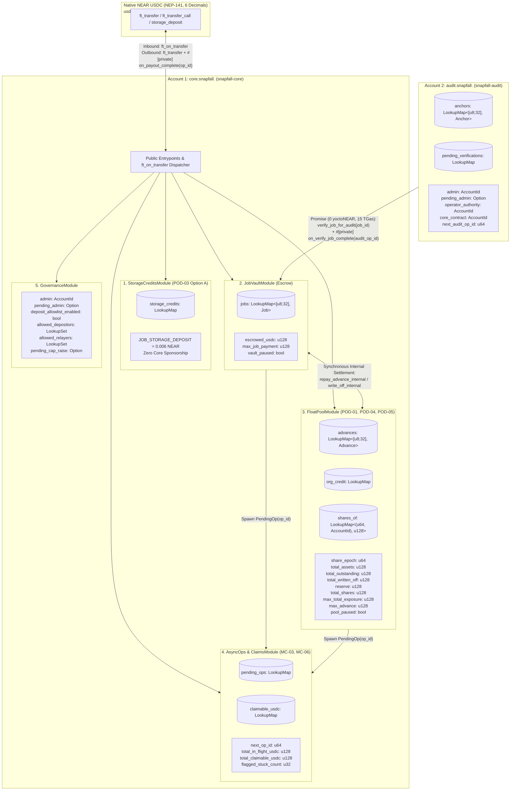

# SNAPFALL NEAR PORT — PHASE 0.7.1: FINAL ARCHITECTURE SPECIFICATION

- **Document Path:** `docs/reports/PHASE_0_7_1_FINAL_ARCHITECTURE_SPECIFICATION.md`
- **Supersedes:** `docs/reports/PHASE_0_7_CORRECTED_ARCHITECTURE_SPECIFICATION.md` (which superseded Phase 0.6)
- **Repository:** `https://github.com/gnanam1990/snapfall`
- **Branch Inspected:** `main` (`b6e1c20`)
- **Specification Date:** 2026-11-12
- **Status:** Final Pre-Implementation Architecture Specification. Preserves approved Product-Owner Decisions `POD-01`..`POD-05`, the hybrid architecture (`core` = JobVault + FloatPool; `audit` = AuditAnchor), and Mandatory Corrections `MC-01`..`MC-07`, plus Phase 0.7.1 corrections `FC-01`..`FC-05`.

---

## 0. Change Log Against Phase 0.7 (`FC-01` .. `FC-05`)

| ID | Phase 0.7 Defect | Phase 0.7.1 Resolution | Affected Sections |
| :--- | :--- | :--- | :--- |
| **`FC-01`** Example 3 arithmetic | §8.2 Example 3 stated LP2 receives `49,999,999` shares and $S = 149{,}999{,}999$. | Recomputed: $50{,}100{,}000 \times 100{,}000{,}001 = 5{,}010{,}000{,}050{,}100{,}000$; $100{,}200{,}001 \times 50{,}000{,}000 = 5{,}010{,}000{,}050{,}000{,}000$; remainder $100{,}000 < 100{,}200{,}001$. **Result: `50,000,000` shares, $S = 150{,}000{,}000$.** Examples 1, 2, 4, 5, 6, 7 re-verified (unchanged; Example 6's `99,999,999` is correct because $87{,}550{,}001 \times 10^8$ exceeds the numerator by $12{,}450{,}000$). T-08 now asserts the exact per-example values. | §8.2, §11 (T-08) |
| **`FC-02`** Native NEAR storage withdrawal | `storage_withdraw()` sent a native NEAR `Promise::transfer` with no failure handling; Phase 0.7 implicitly relied on the USDC `PendingOp` path, which does not apply to native NEAR. | Added a **separate `PendingNearOp` mechanism** (own `near_op_id` counter, own map, own in-flight total, own `#[private] on_storage_withdraw_complete` callback) with synchronous deduction, per-account lock, and additive restoration of `storage_credits` on failure. Full state-transition table in §9.2. | §6.1, §9.2, §10.2, §11 (T-26, T-27) |
| **`FC-03`** Callback execution guarantee | §7.3 claimed a `45 TGas` allocation "guarantees" callback execution. | **Claim removed.** Gas allocation reduces but cannot eliminate callback failure risk. §7.4 now specifies what happens if `on_payout_complete` panics, runs out of gas, or fails after a successful `ft_transfer`: the callback's state changes revert, `PendingOp` remains, funds are treated conservatively as in-flight liabilities, entries are paused, and resolution is manual and **never auto-credits**. | §7.3, §7.4, §8.3, §11 (T-28), §12 |
| **`FC-04`** Storage measurement gate | `0.006 NEAR` was described as sufficient based on an estimated `~440`-byte `Job`. | `0.006 NEAR` is now a **provisional** value. Phase 1 Gate 1 must measure, in Sandbox, the **complete persistent storage delta** of every job-creating path (collection keys, prefixes, Borsh values, index entries, events excluded as non-persistent). Required: `JOB_STORAGE_DEPOSIT >= ceil(1.5 × max_measured_bytes) × storage_byte_cost`, rounded up to the next `0.001 NEAR`. Procedure for adjustment in §9.3. | §9.1, §9.3, §11 (T-25, T-29), §12 |
| **`FC-05`** Dependent consistency review | — | All sections, examples, invariants, tests, and events re-checked for FC-01..FC-04. Mandatory test suite expanded from 25 to **29** tests. Solvency invariants extended with a separate native-NEAR storage invariant (§9.2). | All |

---

## 1. Change Log Against Phase 0.6 (`MC-01` .. `MC-07`)

This Phase 0.7 specification resolves every inconsistency identified in the Phase 0.6 review and locks in all five Product Owner Decisions (`POD-01` through `POD-05`):

| Correction ID | Phase 0.6 Defect / Ambiguity | Phase 0.7 Canonical Resolution | Affected Sections |
| :--- | :--- | :--- | :--- |
| **`MC-01` (POD-03 Storage Policy)** | Phase 0.6 contained conflicting storage rules across Sections 6.1, 9.2, and 13 (`1.00 USDC` vs `5.00 USDC` self-sponsorship floors, `allowed_job_creators` vs `allowed_operators` vs `create_authority`, and `2.0 NEAR` core sponsorship reserve). | **Removed all core-contract storage sponsorship and all self-sponsorship allowlists/thresholds.** Enforced **one canonical storage policy (`POD-03 Option A`)**: every job creation (`create_job` or `ft_on_transfer(CreateAndFundJob)`) requires `JOB_STORAGE_DEPOSIT = 0.006 NEAR` (`6 * 10^21 yoctoNEAR`) paid by the caller (via attached deposit on `create_job` or pre-deposited `storage_credits[caller]` via `storage_deposit`). Zero NEAR from `core.snapfall.<network>`'s operational balance is ever used to sponsor job storage. | §§ 2, 3, 4, 6, 9 |
| **`MC-02` (`AuditAnchor` Cross-Contract Verification)** | Phase 0.6 assumed `audit.snapfall.near` could call `core.get_job` as a "view promise" without verifying how `near-sdk-rs` and the NEAR runtime execute cross-contract calls. | **Verified against official NEAR Protocol documentation and `near-sdk-rs` (`#[ext_contract]`):** On NEAR, cross-contract calls are always asynchronous `FunctionCall` action receipts (there is no synchronous cross-contract `view` RPC inside WASM, but any `&self` non-mutating method exported by `#[near]` is callable via a `0 yoctoNEAR` `Promise` and returns its JSON-serialized value to a `#[private]` callback). Furthermore, to minimize cross-contract serialization payload and gas, `core.snapfall.near` exposes a dedicated non-mutating `&self` method `verify_job_for_audit(job_id) -> AuditJobState` returning only `(exists, status, delivery_hash)`. | §§ 3, 5, 10 |
| **`MC-03` (Stuck-Operation Recovery)** | Phase 0.6 Section 7.4 proposed `reconcile_stuck_op(op_id)` allowing `admin` to credit `claimable_usdc` after `1,000` blocks. If a delayed `usdc.ft_transfer` receipt later succeeded on the token shard, the recipient would be paid **twice**, and the delayed callback would panic on a missing `op_id`. | **Removed `reconcile_stuck_op` auto-crediting completely.** `#[private] on_payout_complete(op_id)` is now the **sole code path** allowed to remove `PendingOp`, decrement `total_in_flight_usdc`, or credit `claimable_usdc`. Added a non-crediting `flag_stuck_op(op_id, reason)` (`admin`-only after `100` blocks) that marks `op.flagged_stuck = true`, engages emergency pause (`vault_paused = true`, `pool_paused = true`), and emits `StuckOpFlagged` for manual investigation while keeping `PendingOp` intact so a late callback still resolves cleanly with zero double-payment risk. | §§ 3, 6, 7, 8 |
| **`MC-04` (POD-04 Symmetric Virtual-Offset Share Math)** | Phase 0.6 defaulted to `1:1` non-offset share math (`POD-04 Option A`) and omitted `redeem(shares)` vs `withdraw(assets)` formulas under virtual offset. | **Specified complete, symmetric virtual-offset share formulas (`POD-04 Option B`)** with `VIRTUAL_ASSETS = 1` and `VIRTUAL_SHARES = 1` for `deposit`, `withdraw(assets)`, `redeem(shares)`, `preview_*`, and `share_price_wad()`, including directional rounding (`floor` on deposit/redeem, `ceil` on withdraw), epoch-based reset on `total_assets == 0` after 100% write-off, and 7 worked numerical examples. | §§ 3, 6, 8 |
| **`MC-05` (Quiescent vs. In-Flight Solvency Invariants)** | Phase 0.6 Section 8.1 stated the quiescent solvency inequality without formally stating the two-shard in-flight conservation law across `total_in_flight_usdc` and `claimable_usdc`. | **Derived and proved both the Quiescent Solvency Invariant ($F_{\text{inflight}} = 0$) and the In-Flight Two-Shard Conservation Invariant ($F_{\text{inflight}} > 0$)** across pending transfers, successful callbacks, failed callbacks, claim credits, claim payouts, and flagged stuck operations. | § 8 |
| **`MC-06` (Callback State-Transition Exclusivity)** | Needed end-to-end verification that no combination of callback failure, retry, or concurrent credit/claim can double-pay, drop claims, or leave dangling locks. | **Proved 1-to-1 bijection between outbound `ft_transfer` promises and `op_id` records**, enforced `active_op_id: Option<u64>` per job/advance, and proved additive commutative restoration on `claimable_usdc`. | §§ 7, 8 |
| **`MC-07` (Signature, Role, & Event Schema Consistency)** | Phase 0.6 had minor signature mismatches (`create_job` parameters, `operator_authority` vs `job.operator` in `core.snapfall.near`, `expected_principal: Option<U128>` vs mandatory `U128`). | **Standardized all method signatures, role names, storage constants, and NEP-297 event schemas** across every table and diagram in this document (`POD-01 Option A`, `POD-02 Option A`, `POD-05 Option B`). | All Sections |

---

## 2. Locked Product-Owner Decisions (`POD-01` .. `POD-05`)

All five Product Owner Decisions are permanently locked as follows:

1. **`POD-01` (`Option A` — `Funded`-Only Advance Eligibility):**
   `request_advance(job_id, expected_principal)` is permitted **only** when `job.status == JobStatus::Funded` (matching `FloatPool.sol:386`). Once `start_work(job_id)` transitions the job to `InProgress`, no new advance may be requested.
2. **`POD-02` (`Option A` — All `Funded` Jobs Eligible by `job.operator`):**
   Every job in `JobStatus::Funded` (with `advances[job_id].status == AdvanceStatus::None`) is eligible for a working-capital advance requested by `job.operator` (`FloatPool.sol:391`). No extra boolean flag is added to `Job`. Customer restitution remains 100% protected on `refund()`.
3. **`POD-03` (`Option A` — Zero Core-Contract Storage Sponsorship):**
   `core.snapfall.<network>` **never** sponsors job storage from its own NEAR balance. Every job creation requires an explicit caller-funded storage stake of `JOB_STORAGE_DEPOSIT = 0.006 NEAR` (`6_000_000_000_000_000_000_000 yoctoNEAR`), supplied either:
   - Directly via attached NEAR deposit on `create_job(...)` (followed by `ft_transfer_call(FundJob)`), **or**
   - Via pre-deposited `storage_credits[sender_id] >= 0.006 NEAR` (funded ahead of time via `storage_deposit`) when using 1-step `ft_transfer_call(CreateAndFundJob)`.
4. **`POD-04` (`Option B` — Symmetric Virtual-Offset Share Accounting):**
   `FloatPool` uses symmetric ERC-4626 virtual-offset share math with `VIRTUAL_ASSETS = 1` (`1` micro-USDC) and `VIRTUAL_SHARES = 1` (`1` micro-share) across all share minting (`DepositPool`), asset withdrawal (`withdraw`), and share redemption (`redeem`) operations, with upward share rounding on `withdraw` and epoch reset if `total_assets` ever reaches `0` while `total_shares > 0`.
5. **`POD-05` (`Option B` — Mandatory `expected_principal: U128`):**
   `request_advance(job_id: Hex32, expected_principal: U128)` requires `expected_principal: U128` as a **mandatory** parameter on every call. If the on-chain computed `principal` does not equal `expected_principal.0`, the transaction panics immediately with `ERR_PRINCIPAL_MISMATCH`.

---

## 3. Corrected Hybrid NEAR Contract Architecture

### 3.1 Two-Account Deployment Topology

1. **`core.snapfall.<network>` (`snapfall-core` crate):**
   Hosts `JobVaultModule` (escrow), `FloatPoolModule` (receivables lending & LP vault), `AsyncOpsModule` (`PendingOp` & `claimable_usdc` fallback ledger), `StorageCreditsModule` (NEP-145 user storage balances), and `GovernanceModule` (timelocks, caps, pauses, allowlists).
2. **`audit.snapfall.<network>` (`snapfall-audit` crate):**
   Hosts `AuditAnchor` with asynchronous cross-contract state verification against `core.snapfall.<network>::verify_job_for_audit`.



### 3.2 Canonical Role Definitions (No Ambiguous Role Names)

| Role Identifier | Contract Where Stored | Who Holds It | Exact Privileges |
| :--- | :--- | :--- | :--- |
| **`admin`** | Both `core` and `audit` | Cold governance account / multisig (rotatable via 2-step, 2-day timelock `transfer_admin` -> `accept_admin`) | Sets `max_job_payment`, `set_caps` (immediate lower / 2-day delayed raise), `set_vault_paused`, `set_pool_paused`, `set_deposit_allowlist_enabled`, `set_depositor_allowed`, `set_relayer_allowed`, `flag_stuck_op`, `create_job`, voluntary/emergency `refund`, `cancel` (`Created` job), and `set_operator_authority` (on `audit`). **Cannot** call `accept_delivery`, `start_work`, `record_expense`, `submit_delivery`, or `request_advance`. |
| **`job.customer`** | `core` (per `Job`) | Customer's NEAR account fixed at job creation | **Sole principal authorized to call `accept_delivery(job_id)` (`SC-JV-005`).** Also authorized to call `ft_transfer_call(FundJob)`, `cancel(job_id)` (when `Created`), and `refund(job_id)` (when `block_timestamp_sec >= job.deadline`). |
| **`job.operator`** | `core` (per `Job`; equals `org` in `FloatPool`) | Organization treasury NEAR account (OutLayer Agent Wallet account) fixed at job creation | **Sole principal authorized to call `start_work`, `record_expense`, `submit_delivery`, and `request_advance` (`SC-FP-004`) for that job.** Also authorized to call `create_job` (when creating a job where `job.operator == caller`), voluntary `refund(job_id)`, and `cancel(job_id)` (when `Created`). Credit history (`accepted_jobs`, `written_off_jobs`, `org_outstanding`) is keyed by `job.operator`. |
| **`operator_authority`** | `audit` only | Operational daemon / OutLayer account on `audit.snapfall.<network>` (rotatable by `admin` via `set_operator_authority`) | **Sole principal authorized to call `anchor_job` on `audit.snapfall.<network>`.** *(Note: `core.snapfall.<network>` does NOT have a global `operator_authority` field; `core` uses per-job `job.operator` and `admin`, matching `JobVault.sol` and `FloatPool.sol` 1:1.)* |

---

## 4. Complete Data Structures & State Machines (`core.snapfall.<network>`)

### 4.1 Core Storage Structs

```rust
pub type Hex32 = [u8; 32]; // JSON-serialized as "0x" + 64 lowercase hex chars

#[derive(BorshDeserialize, BorshSerialize, Serialize, Deserialize, Clone, Copy, Debug, PartialEq, Eq)]
pub enum JobStatus {
    Created = 0,
    Funded = 1,
    InProgress = 2,
    Delivered = 3,
    Accepted = 4,
    Refunded = 5,
    Cancelled = 6,
    // Asynchronous lock states (prevent concurrent mutations while ft_transfer is in flight)
    Settling = 7,
    Refunding = 8,
}

#[derive(BorshDeserialize, BorshSerialize, Clone, Debug)]
pub struct Job {
    pub customer: AccountId,
    pub operator: AccountId,
    pub customer_payment: u128,
    pub max_operating_budget: u128,
    pub onchain_expenses: u128,
    pub terms_hash: Hex32,
    pub delivery_hash: Hex32,
    pub deadline: u64,                 // Unix timestamp in seconds
    pub status: JobStatus,
    pub storage_sponsor: AccountId,    // Account that paid JOB_STORAGE_DEPOSIT (0.006 NEAR)
    pub storage_locked: u128,          // yoctoNEAR locked (6 * 10^21); refunded to storage_credits on cancel()
    pub active_op_id: Option<u64>,     // Non-None while status is Settling or Refunding
}

#[derive(BorshDeserialize, BorshSerialize, Serialize, Deserialize, Clone, Copy, Debug, PartialEq, Eq)]
pub enum AdvanceStatus {
    None = 0,
    PayoutPending = 1, // Async lock while request_advance ft_transfer is in flight
    Issued = 2,        // Active open advance (matches FloatPool.sol AdvanceStatus.Issued)
    Repaid = 3,
    WrittenOff = 4,
}

#[derive(BorshDeserialize, BorshSerialize, Clone, Debug)]
pub struct Advance {
    pub job_id: Hex32,
    pub operator_org: AccountId,
    pub principal: u128,
    pub fee: u128,
    pub rate_bps: u16,
    pub opened_at: u64,                // Unix timestamp in seconds
    pub status: AdvanceStatus,
    pub active_op_id: Option<u64>,     // Non-None while status is PayoutPending
}
```

### 4.2 `JobVault` and `FloatPool` Coupled State Machine Diagram

```mermaid
stateDiagram-v2
    [*] --> Created : create_job()\n[Locks 0.006 NEAR from attached deposit or storage_credits]
    [*] --> Funded : ft_on_transfer(CreateAndFundJob)\n[Deducts 0.006 NEAR from storage_credits[sender_id]]
    
    Created --> Funded : ft_on_transfer(FundJob)\n[sender_id == job.customer OR allowed_relayer]
    Created --> Cancelled : cancel()\n[Credits 0.006 NEAR back to storage_credits[storage_sponsor]]

    state Funded {
        [*] --> NoAdvance
        NoAdvance --> AdvancePayoutPending : request_advance(job_id, expected_principal)\n[job.operator only;POD-01 & POD-05]
        AdvancePayoutPending --> AdvanceIssued : on_payout_complete(op_id)\n[Success OR claimable_usdc fallback]
    }

    Funded --> InProgress : start_work()\n[job.operator only; requires advance != PayoutPending]
    Funded --> Refunding : refund()\n[requires advance != PayoutPending]

    InProgress --> InProgress : record_expense()\n[onchain_expenses + amount <= max_operating_budget]
    InProgress --> Delivered : submit_delivery()\n[delivery_hash != 0x0]
    InProgress --> Refunding : refund()

    Delivered --> Settling : accept_delivery()\n[job.customer ONLY; Pool repaid synchronously FIRST]
    Delivered --> Refunding : refund()

    Settling --> Accepted : on_payout_complete(op_id)\n[Direct transfer OR claimable_usdc[operator] fallback]
    Refunding --> Refunded : on_payout_complete(op_id)\n[Direct transfer OR claimable_usdc[customer] fallback]
```

> **Note on `operator_net > 0` in `accept_delivery`:**
> Because `rate_bps <= 8500` and `FEE_BPS = 200`, `advance_repaid = principal + fee <= 86.7%` of `customer_payment`. Since `customer_payment > 0`, `operator_net = customer_payment - advance_repaid` is **strictly positive (`>= 13.3%` of `customer_payment`) for every funded job**. Therefore, `accept_delivery` always transitions through `Delivered -> Settling -> Accepted`.

---

## 5. Cross-Contract Verification Verification & `AuditAnchor` Design (`MC-02`)

### 5.1 Verification of NEAR Runtime & `near-sdk-rs` Cross-Contract Semantics (`MC-02`)
Per Mandatory Correction 2, we verified how `near-sdk-rs` and the NEAR runtime (`nearcore`) handle cross-contract calls to read-only (`&self`) methods:

1. **Official NEAR Runtime Behavior (Verified Fact):**
   - In the NEAR VM (`nearcore/runtime/near-vm-runner`), external RPC queries (`query` with `request_type: "call_function"`) run in a synchronous `View` context that prohibits promise creation (`promise_create`) and storage writes (`storage_write`).
   - Inside a smart contract transaction, **all** cross-contract interactions use asynchronous receipts (`Action::FunctionCall` spawned via `Promise::new(target).function_call(...)` or `#[ext_contract]`).
   - In `near-sdk-rs` ([docs.rs/near-sdk — Cross-Contract Calls](https://docs.near.org/build/smart-contracts/anatomy/crosscontract)), any public method declared with `&self` (non-mutating view receiver) on a `#[near]` impl block compiles to a standard WASM `extern "C"` export that:
     1. Rejects non-zero attached deposits (`if env::attached_deposit() != 0 { env::panic_str(...) }`),
     2. Reads state via `env::state_read()`,
     3. Skips `env::state_write()`, and
     4. Writes its JSON-serialized return value to the receipt outcome buffer via `env::value_return(...)`.
   - When `audit.snapfall.<network>` invokes a `&self` method on `core.snapfall.<network>` via `Promise` with `NearToken::from_yoctonear(0)` attached deposit, the NEAR runtime executes that receipt on `core`, captures the `value_return` bytes in a `DataReceipt`, and passes them into `audit.snapfall.<network>`'s `#[private]` callback via `#[callback_result] Result<T, PromiseError>`.

2. **Dedicated Minimal Verification Interface on `core.snapfall.<network>`:**
   Rather than serializing the full `Job` struct across the receipt boundary, `core.snapfall.<network>` exposes a dedicated, minimal `&self` verification method:
   ```rust
   #[derive(Serialize, Deserialize, Clone, Debug, PartialEq, Eq)]
   pub struct AuditJobVerification {
       pub exists: bool,
       pub status: Option<JobStatus>,
       pub delivery_hash: Option<Hex32>,
   }

   // On core.snapfall.<network>:
   pub fn verify_job_for_audit(&self, job_id: Hex32) -> AuditJobVerification {
       match self.jobs.get(&job_id) {
           Some(job) => AuditJobVerification {
               exists: true,
               status: Some(job.status),
               delivery_hash: Some(job.delivery_hash),
           },
           None => AuditJobVerification {
               exists: false,
               status: None,
               delivery_hash: None,
           },
       }
   }
   ```

### 5.2 `audit.snapfall.<network>` State Machine & Callback Handling
```rust
#[derive(BorshDeserialize, BorshSerialize, Serialize, Deserialize, Clone, Debug, PartialEq, Eq)]
pub struct Anchor {
    pub event_root: Hex32,
    pub payment_receipt_root: Hex32,
    pub delivery_hash: Hex32,
    pub completed_at: u64,
    pub anchored_at_sec: u64,
    pub finalized: bool,
}

#[derive(BorshDeserialize, BorshSerialize, Clone, Debug)]
pub struct PendingAnchor {
    pub audit_op_id: u64,
    pub job_id: Hex32,
    pub event_root: Hex32,
    pub payment_receipt_root: Hex32,
    pub delivery_hash: Hex32,
    pub completed_at: u64,
}
```
1. **`anchor_job(job_id, event_root, payment_receipt_root, delivery_hash, completed_at)`:**
   - Requires `env::predecessor_account_id() == self.operator_authority` (`NotAuthorized`).
   - Requires `env::prepaid_gas() >= Gas::from_tgas(60)` (`15 TGas` for `core::verify_job_for_audit` + `25 TGas` for `on_verify_job_complete` + `20 TGas` entrypoint).
   - Requires `event_root != [0;32]` and `delivery_hash != [0;32]`.
   - Requires `!self.anchors.contains_key(&job_id)` (`AlreadyFinalized`).
   - Requires `!self.jobs_pending_anchor.contains(&job_id)` (`ERR_ANCHOR_IN_FLIGHT`).
   - Allocates `audit_op_id = self.next_audit_op_id`, inserts `self.jobs_pending_anchor.insert(job_id)` and `self.pending_verifications.insert(audit_op_id, PendingAnchor { ... })`.
   - Dispatches `ext_core::ext(self.core_contract.clone()).with_static_gas(Gas::from_tgas(15)).with_attached_deposit(NearToken::from_yoctonear(0)).verify_job_for_audit(job_id).then(Self::ext(env::current_account_id()).with_static_gas(Gas::from_tgas(25)).on_verify_job_complete(audit_op_id))`.
2. **`#[private] on_verify_job_complete(&mut self, audit_op_id: u64, #[callback_result] res: Result<AuditJobVerification, PromiseError>) -> bool`:**
   - Removes `pending = self.pending_verifications.remove(&audit_op_id).expect("ERR_UNKNOWN_AUDIT_OP")` and removes `self.jobs_pending_anchor.remove(&pending.job_id)`.
   - Checks `res`:
     - If `Ok(v)` where `v.exists && v.status == Some(JobStatus::Accepted) && v.delivery_hash == Some(pending.delivery_hash)`:
       - Inserts `Anchor { event_root: pending.event_root, payment_receipt_root: pending.payment_receipt_root, delivery_hash: pending.delivery_hash, completed_at: pending.completed_at, anchored_at_sec: block_timestamp_sec(), finalized: true }` into `self.anchors`.
       - Emits NEP-297 `JobAnchored`. Returns `true`.
     - Otherwise (job not yet `Accepted`, `delivery_hash` mismatch, or cross-contract call error):
       - Does **not** insert into `self.anchors` (leaving `job_id` unfinalized so a future valid `anchor_job` call can succeed once the job is `Accepted`).
       - Emits NEP-297 `AnchorVerificationFailed { jobId, reason }`. Returns `false`.

---

## 6. Canonical Authorization & Method Specification Matrix (`MC-01`, `MC-07`)

### 6.1 `core.snapfall.<network>` Complete Method Matrix

| Category | Method Signature | Allowed Caller (`predecessor_account_id`) | Attached Deposit | Blocked by Pause? | Exact Preconditions & Effects |
| :--- | :--- | :--- | :--- | :--- | :--- |
| **Init** | `new(usdc_token: AccountId, admin: AccountId)` | Contract account (`#[init]`) | `0` | N/A | Sets `usdc_token`, `admin`, `deposit_allowlist_enabled = true`, `allowed_depositors = {admin}`, `share_epoch = 1`, all caps = `0` (fail closed). |
| **Storage (`POD-03A`)** | `storage_deposit(account_id: Option<AccountId>)` | Any account | `>= 0.006 NEAR` (`6e21 yocto`) | No | Credits `storage_credits[account_id.unwrap_or(caller)] += attached_deposit`. Emits `StorageDeposited`. |
| **Storage (`POD-03A`)** | `storage_withdraw(amount: Option<NearToken>)` | Any account with no active `PendingNearOp` | `1 yoctoNEAR` | No | **(FC-02)** Requires `0 < amt <= storage_credits[caller]` where `amt = amount.unwrap_or(storage_credits[caller])`, and `storage_withdraw_lock[caller].is_none()`. Synchronously deducts `storage_credits[caller] -= amt`, adds `total_inflight_storage_near += amt`, allocates `near_op_id`, stores `PendingNearOp`, sets lock, then dispatches `Promise::transfer(caller, amt).then(on_storage_withdraw_complete(near_op_id))`. Locked `job.storage_locked` amounts are never withdrawable. See §9.2. |
| **Storage callback (FC-02)** | `on_storage_withdraw_complete(near_op_id: u64)` | `#[private]` | `0` | N/A | If `near_op_id` absent: log `StorageWithdrawAnomaly` and return (no panic, no credit). Success: remove op, `total_inflight_storage_near -= amt`, clear lock, emit `StorageWithdrawn`. Failure: remove op, `total_inflight_storage_near -= amt`, `storage_credits[account] += amt` (additive), clear lock, emit `StorageWithdrawFailed`. |
| **JobVault** | `create_job(job_id: Hex32, customer: AccountId, operator: AccountId, customer_payment: U128, max_operating_budget: U128, terms_hash: Hex32, deadline: u64)` | `admin` OR `operator` (`caller == admin \|\| caller == operator`, `JobVault.sol:173`) | `>= 0.006 NEAR` OR `0` if `storage_credits[caller] >= 0.006 NEAR` | **Yes (`vault_paused`)** | Requires `!jobs.contains_key(&job_id)`, `max_job_payment > 0`, `0 < customer_payment <= max_job_payment`. Locks `0.006 NEAR` in `job.storage_locked` (any excess attached NEAR is added to `storage_credits[caller]`). Status = `Created`. Emits `JobCreated`. |
| **NEP-141 (`POD-03A`)** | `ft_on_transfer(sender_id, amount, msg: CreateAndFundJob { job_id, operator, max_operating_budget, terms_hash, deadline })` | **`self.usdc_token` ONLY** (`job.customer` is fixed to `sender_id`) | `0` (NEP-141) | **Yes (`vault_paused`)** | Requires `!jobs.contains_key(&job_id)`, `max_job_payment > 0`, `0 < amount <= max_job_payment`, and **`storage_credits[sender_id] >= 0.006 NEAR`** (`POD-03 Option A` — deducts `0.006 NEAR` from `storage_credits[sender_id]`). Creates job with `customer = sender_id`, `customer_payment = amount`, `status = Funded`, `escrowed_usdc += amount`. Emits `JobCreated` + `JobFunded`. Returns `U128(0)`. |
| **NEP-141** | `ft_on_transfer(sender_id, amount, msg: FundJob { job_id })` | **`self.usdc_token` ONLY** (`sender_id == job.customer \|\| allowed_relayers.contains(&sender_id)`) | `0` (NEP-141) | **Yes (`vault_paused`)** | Requires `job.status == Created`, `amount == job.customer_payment`. Sets `job.status = Funded`, `escrowed_usdc += amount`. Emits `JobFunded`. Returns `U128(0)`. |
| **NEP-141 (`POD-04B`)** | `ft_on_transfer(sender_id, amount, msg: DepositPool { receiver })` | **`self.usdc_token` ONLY** (`!deposit_allowlist_enabled \|\| allowed_depositors.contains(&sender_id)`) | `0` (NEP-141) | **Yes (`pool_paused`)** | Requires `amount >= MIN_DEPOSIT_USDC` (`1_000_000`). Computes `shares = preview_deposit(amount)`. Mints `shares` to `receiver.unwrap_or(sender_id)` in current `share_epoch`, `total_shares += shares`, `total_assets += amount`. Emits `Deposited`. Returns `U128(0)`. |
| **JobVault** | `start_work(job_id: Hex32)` | **`job.operator` ONLY** (`JobVault.sol:229`) | `0` | **No** | Requires `job.status == Funded` and `advances[job_id].status != PayoutPending`. Sets `job.status = InProgress`. Emits `WorkStarted`. |
| **JobVault** | `record_expense(job_id: Hex32, amount: U128, receipt_hash: Hex32)` | **`job.operator` ONLY** (`JobVault.sol:246`) | `0` | **No** | Requires `job.status == InProgress`, `amount > 0`, `job.onchain_expenses + amount <= job.max_operating_budget`. Updates `onchain_expenses`. Emits `ExpenseRecorded`. |
| **JobVault** | `submit_delivery(job_id: Hex32, delivery_hash: Hex32)` | **`job.operator` ONLY** (`JobVault.sol:264`) | `0` | **No** | Requires `job.status == InProgress`, `delivery_hash != [0;32]`. Sets `job.delivery_hash = delivery_hash`, `job.status = Delivered`. Emits `DeliverySubmitted`. |
| **JobVault** | `accept_delivery(job_id: Hex32)` | **`job.customer` ONLY** (`JobVault.sol:289`, `[CRIT-01]`) | `0` or `1 yoctoNEAR` | **No** | Requires `job.status == Delivered`, `prepaid_gas >= 110 TGas`. Executes synchronous `repay_advance_internal(job_id)` first, sets `job.status = Settling`, allocates `op_id`, dispatches `usdc.ft_transfer(job.operator, operator_net)`. |
| **JobVault** | `refund(job_id: Hex32)` | `job.operator` OR `admin` (anytime), OR `job.customer` if `block_timestamp_sec() >= job.deadline` (`JobVault.sol:335-342`) | `0` or `1 yoctoNEAR` | **No** | Requires `job.status in {Funded, InProgress, Delivered}`, `advances[job_id].status != PayoutPending`, `prepaid_gas >= 110 TGas`. Executes synchronous `write_off_internal(job_id)` if advance `Issued`, sets `job.status = Refunding`, allocates `op_id`, dispatches `usdc.ft_transfer(job.customer, job.customer_payment)`. |
| **JobVault** | `cancel(job_id: Hex32)` | `job.customer` OR `job.operator` OR `admin` (`JobVault.sol:373`) | `0` | **No** | Requires `job.status == Created`. Sets `job.status = Cancelled`, refunds `job.storage_locked` (`0.006 NEAR`) to `storage_credits[job.storage_sponsor]`, sets `job.storage_locked = 0`. Emits `JobCancelled`. |
| **FloatPool (`POD-01A`, `POD-05B`)** | `request_advance(job_id: Hex32, expected_principal: U128)` | **`job.operator` ONLY** (`FloatPool.sol:391`) | `0` | **Yes (`pool_paused`)** | Requires `max_total_exposure > 0 && max_advance > 0`, **`job.status == Funded`** (`POD-01A`), `advances[job_id].status == None`, `prepaid_gas >= 110 TGas`. Computes `principal` and `fee`, asserts **`principal == expected_principal.0`** (`POD-05B`), checks 4 caps, sets `advances[job_id].status = PayoutPending`, allocates `op_id`, dispatches `usdc.ft_transfer(job.operator, principal)`. |
| **FloatPool (`POD-04B`)** | `withdraw(assets: U128, receiver: Option<AccountId>)` | LP (`shares_of[(epoch, caller)] >= shares`) | `1 yoctoNEAR` | **No** | Computes `shares = preview_withdraw(assets)` (rounded UP), requires `shares <= shares_of[(epoch, caller)]` and `assets <= total_assets - total_outstanding`, burns `shares`, deducts `total_assets -= assets`, allocates `op_id`, dispatches `usdc.ft_transfer(receiver.unwrap_or(caller), assets)`. |
| **FloatPool (`POD-04B`)** | `redeem(shares: U128, receiver: Option<AccountId>)` | LP (`shares_of[(epoch, caller)] >= shares`) | `1 yoctoNEAR` | **No** | Computes `assets = preview_redeem(shares)` (rounded DOWN), requires `assets > 0` and `assets <= total_assets - total_outstanding`, burns `shares`, deducts `total_assets -= assets`, allocates `op_id`, dispatches `usdc.ft_transfer(receiver.unwrap_or(caller), assets)`. |
| **Claims** | `claim_usdc(amount: Option<U128>, recipient: Option<AccountId>)` | Account with `claimable_usdc[caller] >= claim_amt > 0` | `1 yoctoNEAR` | **No** | Deducts `claimable_usdc[caller] -= claim_amt` and `total_claimable_usdc -= claim_amt`, allocates `op_id`, dispatches `usdc.ft_transfer(recipient.unwrap_or(caller), claim_amt)`. |
| **Gov** | `set_vault_paused(paused: bool)` / `set_pool_paused(paused: bool)` | `admin` ONLY | `1 yoctoNEAR` | N/A | Toggles entry circuit breakers. |
| **Gov** | `set_max_job_payment(max_job_payment: U128)` | `admin` ONLY | `1 yoctoNEAR` | N/A | Requires `max_job_payment > 0`. |
| **Gov** | `set_caps(max_total_exposure: U128, max_advance: U128)` | `admin` ONLY | `1 yoctoNEAR` | N/A | Both `> 0`; rejects mixed raise+lower (`ERR_MIXED_CAP_CHANGE`); applies immediately on first set or lower; queues for `172,800s` (`2 days`) on raise. |
| **Gov** | `execute_caps_raise()` / `cancel_caps_raise()` | **`admin` ONLY** | `1 yoctoNEAR` | N/A | Executes after `cap_raise_executable_at` or cancels pending raise. |
| **Gov** | `set_deposit_allowlist_enabled(enabled: bool)` / `set_depositor_allowed(account: AccountId, allowed: bool)` / `set_relayer_allowed(account: AccountId, allowed: bool)` | `admin` ONLY | `1 yoctoNEAR` | N/A | Manages LP deposit allowlist and NEAR Intents relayer allowlist for `FundJob`. |
| **Gov** | `transfer_admin(new_admin: AccountId)` / `accept_admin()` | `admin` / `pending_admin` | `1 yoctoNEAR` | N/A | 2-step, 2-day (`172,800s`) delayed admin transfer. |
| **Investigation (`MC-03`)** | `flag_stuck_op(op_id: u64, note: String)` | `admin` ONLY | `1 yoctoNEAR` | N/A | Requires `pending_ops.contains_key(&op_id)` and `block_height() >= op.created_at_block + 100`. Sets `op.flagged_stuck = true`, sets `vault_paused = true` and `pool_paused = true`, emits `StuckOpFlagged`. **Does NOT credit `claimable_usdc` or remove `op_id`.** |

---

## 7. Asynchronous NEP-141 Transfer Safety & Non-Crediting Stuck-Op Design (`MC-03`, `MC-06`)

### 7.1 Bijection Between Outbound Promises and `op_id`
Every outbound `usdc.ft_transfer` is assigned a strictly monotonic `op_id: u64` (`self.next_op_id += 1`) before the `Promise` is constructed:

```rust
#[derive(BorshDeserialize, BorshSerialize, Serialize, Deserialize, Clone, Debug)]
pub struct PendingOp {
    pub op_id: u64,
    pub kind: PendingOpKind,
    pub recipient: AccountId,
    pub amount: u128,
    pub created_at_block: u64,
    pub created_at_sec: u64,
    pub flagged_stuck: bool,
}
```

### 7.2 Why `on_payout_complete(op_id)` Cannot Double-Pay or Lose Claims
1. **Single Authority to Resolve `PendingOp`:** Only `#[private] pub fn on_payout_complete(&mut self, op_id: u64)` can remove `op_id` from `self.pending_ops` or decrement `self.total_in_flight_usdc`.
2. **Per-Entity Lock Exclusivity:**
   - When `request_advance` spawns `op_id`, `advance.status` is set to `PayoutPending` and `advance.active_op_id = Some(op_id)`. While `advance.status == PayoutPending`, `start_work`, `accept_delivery`, `refund`, and `request_advance` all reject calls for `job_id`.
   - When `accept_delivery` spawns `op_id`, `job.status` is set to `Settling` and `job.active_op_id = Some(op_id)`. No other method can mutate `job_id`.
   - When `refund` spawns `op_id`, `job.status` is set to `Refunding` and `job.active_op_id = Some(op_id)`. No other method can mutate `job_id`.
   - When `withdraw`, `redeem`, or `claim_usdc` spawns `op_id`, the burned shares (`shares_of[(epoch, lp)] -= shares`) or claimed USDC (`claimable_usdc[owner] -= claim_amt`) are **deducted synchronously in the entrypoint before the promise is spawned**. Thus, even if the user immediately calls `withdraw` or `claim_usdc` a second time in the same block, their balance has already been decremented!
3. **Commutative Additive Restoration on `claimable_usdc`:**
   - Suppose Operator has `claimable_usdc[op] = 10 USDC` and calls `claim_usdc(10 USDC)` (`op_id = 1`). Synchronously, `claimable_usdc[op]` becomes `0`.
   - While `op_id = 1` is in flight, Job B's settlement transfer (`op_id = 2`, `5 USDC`) fails its direct transfer because `op` is unregistered on `usdc.<network>`. `on_payout_complete(2)` executes `claimable_usdc[op] += 5 USDC` -> `claimable_usdc[op]` is now `5 USDC`.
   - Next, `op_id = 1` (`10 USDC` claim) also fails its transfer on `usdc.<network>`. `on_payout_complete(1)` executes `claimable_usdc[op] += 10 USDC` -> `claimable_usdc[op]` becomes `5 + 10 = 15 USDC`!
   - Regardless of the arrival order of `on_payout_complete(1)` and `on_payout_complete(2)`, integer addition (`+=`) is commutative and associative: the operator's exact `15 USDC` claimable balance is preserved without loss or double-counting.

### 7.3 Redesigned Stuck-Operation Handling (`MC-03`)

In Phase 0.6, Section 7.4 allowed `reconcile_stuck_op(op_id)` to credit `claimable_usdc` after `1,000` blocks. **That mechanism has been eliminated in Phase 0.7** because a block-height threshold on `core.snapfall.<network>` cannot prove that a cross-shard receipt on `usdc.<network>` will not eventually execute.

Instead, Phase 0.7 enforces the following **provably safe 3-rule recovery design**:

1. **Defensive Callback Design (Risk Reduction — NOT a Guarantee, FC-03):**
   `on_payout_complete(op_id)` is allocated a fixed `45 TGas` (provisional; Phase 1 T-25 measures actual burn), performs no external calls, uses no `unwrap`/`expect`, handles a missing `op_id` by logging `PayoutCallbackAnomaly` and returning, and handles both `PromiseResult::Successful` and `PromiseResult::Failed`. The NEAR runtime does schedule the callback receipt once the `ft_transfer` receipt resolves, but **nothing guarantees that the callback execution itself succeeds**: it can still fail due to a code defect, an arithmetic overflow guard, storage-staking shortfall on `core`, gas exhaustion (e.g. unexpected state growth or protocol gas-cost changes), or a contract upgrade that changed the callback ABI. Section 7.4 specifies the behaviour in those cases.
2. **Non-Crediting Investigation Flag (`flag_stuck_op`):**
   If an operation remains in `pending_ops` for `>= 100 blocks` (`~1.5 minutes`), `admin` (or the daemon's automated monitor) can invoke `flag_stuck_op(op_id, note)`:
   - Sets `op.flagged_stuck = true` and increments `self.flagged_stuck_count += 1`.
   - Engages the protective circuit breakers (`self.vault_paused = true; self.pool_paused = true`) so no new jobs or advances enter while an abnormal runtime receipt delay exists.
   - Emits NEP-297 `StuckOpFlagged { opId, recipient, amountAtomic, createdAtBlock, note }`.
   - **Crucially:** `op` remains in `pending_ops` and `total_in_flight_usdc` remains unchanged.
3. **Late Callback Resolution After Flagging:**
   If the delayed `on_payout_complete(op_id)` callback arrives **after** `flag_stuck_op(op_id)` was called, `on_payout_complete(op_id)` still finds `op` in `pending_ops`, sees `op.flagged_stuck == true`, decrements `self.flagged_stuck_count -= 1`, and processes the `Successful` or `Failed` outcome normally—emitting `StuckOpResolved { opId, outcome }` with **zero possibility of double payment**!

### 7.4 Callback Execution Failure After the Transfer Has Resolved (FC-03)

**Facts about NEAR semantics relied upon:** (a) a receipt that panics or exhausts gas has all of *its own* state changes reverted; (b) the earlier `usdc.ft_transfer` receipt is *not* reverted by a later callback failure; (c) the NEAR runtime does not automatically retry a failed callback receipt; (d) a `#[private]` callback can only be invoked by the contract itself, so it cannot be re-run by an external caller.

**Consequences when `on_payout_complete(op_id)` fails:**

| Underlying `ft_transfer` outcome | Real USDC position | `core` state after failed callback | Risk |
| :--- | :--- | :--- | :--- |
| Succeeded (recipient paid) | $B_{\text{USDC}}$ reduced by `amount` | `PendingOp` still present; `total_in_flight_usdc` still includes `amount`; job stays `Settling`/`Refunding` or advance stays `PayoutPending`; no `claimable_usdc` credit | No loss. Liability overstated by `amount` (conservative). Entity remains locked. |
| Failed (recipient not paid) | $B_{\text{USDC}}$ unchanged | Same as above | No loss. Funds held by `core`, accounted in $F_{\text{inflight}}$, not yet claimable by recipient. |

In both rows, Theorem 1 (§8.3) still holds: the op is in $\mathcal{P}$, so $F_{\text{inflight}}$ covers it whether or not the USDC actually moved. No accounting state claims funds that do not exist.

**Conservative accounting rules:**
1. A `PendingOp` whose callback has failed is treated as a **live liability** for its full `amount`: it is excluded from idle pool cash, escrow, reserve and claimables, and is never re-used.
2. `total_in_flight_usdc` is never decremented except inside a successful execution of `on_payout_complete`.
3. No method may re-dispatch an `ft_transfer` for an existing `op_id`.

**Detection and pause:** The daemon monitor (Phase 2) reads `pending_ops` each block. Any op older than `100` blocks, or any op for which the indexer observes a failed callback receipt (`ExecutionStatus::Failure` on the receipt calling `on_payout_complete`), triggers `flag_stuck_op(op_id, note)`, which pauses entries (`vault_paused`, `pool_paused`) without crediting anything. Exits (`withdraw`, `redeem`, `claim_usdc`, `cancel`, `accept_delivery`, `refund`) remain available for *other* entities.

**Manual investigation procedure (no on-chain auto-resolution in Phase 1):**
1. Admin retrieves the `ft_transfer` receipt outcome and the callback receipt outcome from an archival RPC node and records both receipt IDs and the `usdc` `ft_transfer` event log.
2. Admin computes the expected reconciled balance and compares with `usdc.ft_balance_of(core)` using Theorem 1.
3. Findings are written to an off-chain incident record and the incident hash is posted via `flag_stuck_op` `note`.
4. **Phase 1 provides no admin method that removes a `PendingOp` or credits `claimable_usdc`.** Any such method would rely on admin attestation of a cross-contract outcome and could double-pay if wrong. Resolution of a permanently stuck op is deferred to a separately reviewed, timelocked governance action (contract upgrade or dedicated method) specified before mainnet, requiring product-owner and security sign-off. Until then the funds remain safely locked and counted as in-flight.
5. Entries remain paused until the admin explicitly unpauses after the investigation is recorded.

This preserves the no-automatic-crediting rule: there is no ordering of callback success, callback failure, flagging, or admin action in Phase 1 that can pay a recipient twice.

---

## 8. Re-Derived Accounting Formulas, Symmetric Virtual-Offset Share Math & Solvency Proofs (`MC-04`, `MC-05`)

### 8.1 Symmetric Virtual-Offset Share Accounting (`POD-04 Option B`, `MC-04`)

Let:
- $A = \text{pool.total\_assets} \in \mathbb{N}_0$ (LP-owned capital in atomic micro-USDC = idle LP cash + `total_outstanding`; excludes `reserve`).
- $O = \text{pool.total\_outstanding} \in \mathbb{N}_0$ (open advance principals in `PayoutPending` or `Issued` state).
- $I = A - O \ge 0$ (derived idle LP cash available for advances or LP withdrawals/redemptions).
- $S = \text{pool.total\_shares} \in \mathbb{N}_0$ (total active LP shares in the current `share_epoch`).
- $V_A = 1$ (`VIRTUAL_ASSETS: u128 = 1`) and $V_S = 1$ (`VIRTUAL_SHARES: u128 = 1`).
- $\text{MIN\_DEPOSIT\_USDC} = 1{,}000{,}000$ (`1.00 USDC`).

#### Exact Share & Asset Conversion Formulas

| Operation | Exact Formula (Using `u256` Intermediate Arithmetic) | Rounding Direction | Preconditions & Error Codes |
| :--- | :--- | :--- | :--- |
| **`preview_deposit(assets)`** *(Used by `DepositPool`)* | $$\text{shares} = \left\lfloor \frac{\text{assets} \times (S + 1)}{A + 1} \right\rfloor$$ | **DOWN (`floor`)** — favors existing pool LPs | `assets >= 1_000_000` (`ERR_BELOW_MIN_DEPOSIT`); `shares > 0` (`ERR_ZERO_SHARES`). Updates: $S' = S + \text{shares}$, $A' = A + \text{assets}$. |
| **`preview_withdraw(assets)`** *(Used by `withdraw(assets, receiver)`)* | $$\text{shares} = \left\lceil \frac{\text{assets} \times (S + 1)}{A + 1} \right\rceil = \left\lfloor \frac{\text{assets} \times (S + 1) + A}{A + 1} \right\rfloor$$ | **UP (`ceil`)** — charges rounding dust to withdrawer | `assets > 0` (`ERR_ZERO_AMOUNT`); `assets <= A - O` (`ERR_INSUFFICIENT_LIQUIDITY`); `shares <= shares_of[(epoch, caller)]` (`ERR_INSUFFICIENT_SHARES`). Updates: $S' = S - \text{shares}$, $A' = A - \text{assets}$. |
| **`preview_redeem(shares)`** *(Used by `redeem(shares, receiver)`)* | $$\text{assets} = \left\lfloor \frac{\text{shares} \times (A + 1)}{S + 1} \right\rfloor$$ | **DOWN (`floor`)** — leaves rounding dust in pool | `shares > 0` (`ERR_ZERO_SHARES`); `shares <= shares_of[(epoch, caller)]` (`ERR_INSUFFICIENT_SHARES`); `assets > 0` (`ERR_ZERO_ASSETS`); `assets <= A - O` (`ERR_INSUFFICIENT_LIQUIDITY`). Updates: $S' = S - \text{shares}$, $A' = A - \text{assets}$. |
| **`share_price_wad()`** *(Read-only 18-decimal view)* | $$\text{price\_wad} = \left\lfloor \frac{(A + 1) \times 10^{18}}{S + 1} \right\rfloor$$ | **DOWN (`floor`)** | Never divides by zero since $S + 1 \ge 1$. At $(A=0, S=0)$, returns $10^{18}$ (`1.000000000000000000`). |

#### Zero-Asset & Full Write-Off Epoch Reset Rule (`A == 0 && S > 0`)
- Under normal operation, `UTILIZATION_CAP_BPS = 8000` (80% max utilization) ensures at least 20% of $A$ remains idle when advances are issued.
- However, if an LP withdraws all idle cash while an advance is open, and that open advance subsequently suffers a 100% write-off with `reserve == 0`, `write_off_internal` sets $A' = A - \text{socialized} = 0$ while $S > 0$.
- Whenever $A$ reaches `0` while $S > 0$ (either at the end of `write_off_internal` or `withdraw`/`redeem`), all underlying LP capital in the current epoch has been exhausted (`0` assets remain). The contract immediately executes:
  ```rust
  if self.pool.total_assets == 0 && self.pool.total_shares > 0 {
      self.pool.total_shares = 0;
      self.pool.share_epoch += 1;
      events::emit_pool_epoch_reset(self.pool.share_epoch);
  }
  ```
- **Why this is essential:** If $S > 0$ were left active when $A = 0$, a new LP depositing `100 USDC` (`100_000_000`) into $(A=0, S=100{,}000{,}000)$ would mint $\lfloor 10^8 \times (10^8 + 1) / (0 + 1) \rfloor \approx 10^{16}$ shares, and the wiped-out previous epoch shareholders would still own $10^8 / 10^{16} = 10^{-8}$ of the new depositor's capital! Incrementing `share_epoch` and resetting `total_shares = 0` in $O(1)$ storage operations ensures that wiped-out shares cannot claim a single atomic unit of post-recapitalization deposits, and the new epoch starts cleanly at $(A = 0, S = 0)$ (`1:1` initial rate).

---

### 8.2 Seven Worked Numerical Examples of Symmetric Virtual-Offset Share Math

1. **Example 1 — First Deposit into Empty Pool $(A=0, S=0, \text{epoch}=1)$:**
   - LP1 deposits $\text{assets} = 100{,}000{,}000$ (`100.00 USDC`).
   - $\text{shares} = \lfloor 100{,}000{,}000 \times (0 + 1) / (0 + 1) \rfloor = 100{,}000{,}000$.
   - Post-state: $A = 100{,}000{,}000$, $S = 100{,}000{,}000$, `shares_of[(1, LP1)] = 100_000_000`, `share_price_wad() = 1_000_000_000_000_000_000`.
2. **Example 2 — Exact Round-Trip Withdrawal at Par $(A=100{,}000{,}000, S=100{,}000{,}000)$:**
   - LP1 calls `withdraw(assets = 100_000_000)`:
     $$\text{shares} = \left\lfloor \frac{100{,}000{,}000 \times 100{,}000{,}001 + 100{,}000{,}000}{100{,}000{,}001} \right\rfloor = \left\lfloor \frac{10{,}000{,}000{,}200{,}000{,}000}{100{,}000{,}001} \right\rfloor = 100{,}000{,}000$$
   - LP1 burns all `100_000_000` shares and receives all `100_000_000` micro-USDC (`0` dust trapped!). Post-state: $(A=0, S=0)$.
3. **Example 3 — Second Deposit After Yield Accrual:**
   - Start: $A = 100{,}000{,}000$, $S = 100{,}000{,}000$, $R = 0$.
   - A `25.00 USDC` job draws a `12.50 USDC` (`12_500_000`) advance at `5000 bps` with `fee = 250_000` (`0.25 USDC`).
   - On `accept_delivery`, `to_reserve = (250_000 * 2000) / 10_000 = 50_000` (`0.05 USDC`) and `lp_yield = 250_000 - 50_000 = 200_000` (`0.20 USDC`).
   - State becomes $A = 100{,}200{,}000$, $S = 100{,}000{,}000$, $R = 50{,}000$.
   - Now LP2 deposits $\text{assets} = 50{,}100{,}000$ (`50.10 USDC`):
     $$\text{shares} = \left\lfloor \frac{50{,}100{,}000 \times (100{,}000{,}000 + 1)}{100{,}200{,}000 + 1} \right\rfloor = \left\lfloor \frac{5{,}010{,}000{,}050{,}100{,}000}{100{,}200{,}001} \right\rfloor = 50{,}000{,}000 \text{ shares}$$
   - Check (FC-01): $100{,}200{,}001 \times 50{,}000{,}000 = 5{,}010{,}000{,}050{,}000{,}000$; remainder $= 100{,}000 < 100{,}200{,}001$, so the floor is exactly `50,000,000`.
   - State becomes $A = 150{,}300{,}000$, $S = 150{,}000{,}000$. LP2 holds exactly one third of shares for one third of assets (`50.10 / 150.30`), as expected at the post-yield price of `1.002`.
4. **Example 4 — Donation Immunity Against Share Inflation Attack:**
   - Attacker deposits minimum `1_000_000` (`1.00 USDC`) into $(A=0, S=0)$, receiving $S = 1{,}000{,}000$ shares.
   - Attacker transfers `100_000_000` (`100.00 USDC`) directly to `core.snapfall.near` on `usdc.<network>` via `ft_transfer` (bypassing `ft_on_transfer`).
   - Because $A$ is an internal state variable (`total_assets = 1_000_000`) and never reads `usdc.ft_balance_of(core)`, $A$ remains `1_000_000`! Victim depositing `2_000_000` (`2.00 USDC`) receives $\lfloor 2{,}000{,}000 \times 1{,}000{,}001 / 1{,}000{,}001 \rfloor = 2{,}000{,}000$ shares (`0` loss to attacker).
5. **Example 5 — Partial Loss Absorbed by Reserve + Socialized LP Loss:**
   - State: $A = 100{,}000{,}000$, $S = 100{,}000{,}000$, $O = 12{,}500{,}000$, $R = 50{,}000$.
   - Job defaults via `refund()`: `loss = 12_500_000`.
   - Stage 1: `bond_slashed = 0`.
   - Stage 2: `reserve_used = min(12_500_000, 50_000) = 50_000` $\implies R' = 0$.
   - Stage 3: `socialized = 12_500_000 - 50_000 = 12_450_000` $\implies A' = 100{,}000{,}000 - 12{,}450{,}000 = 87{,}550{,}000$, $O' = 0$.
   - Derived idle LP cash: $I' = A' - O' = 87{,}550{,}000 - 0 = 87{,}550{,}000$, which equals the exact physical cash remaining in the pool (`100_000_000 + 50_000 - 12_500_000 = 87_550_000`)!
6. **Example 6 — Deposit After Partial Write-Off $(A = 87{,}550{,}000, S = 100{,}000{,}000)$:**
   - LP2 deposits `87_550_000` (`87.55 USDC`):
     $$\text{shares} = \left\lfloor \frac{87{,}550{,}000 \times 100{,}000{,}001}{87{,}550{,}001} \right\rfloor = 99{,}999{,}999 \text{ shares}$$
   - Post-state: $A = 175{,}100{,}000$, $S = 199{,}999{,}999$.
7. **Example 7 — Full Wipeout $(A = 0, S > 0)$ & Epoch Reset:**
   - Suppose $A = 100{,}000{,}000, S = 100{,}000{,}000, O = 50{,}000{,}000, R = 0$.
   - LP1 withdraws all idle cash `withdraw(50_000_000)`: burns `50_000_000` shares $\implies A = 50{,}000{,}000, S = 50{,}000{,}000, O = 50{,}000{,}000$.
   - The `50_000_000` advance defaults via `refund()`: `socialized = 50_000_000` $\implies A' = 0, O' = 0, S = 50{,}000{,}000$.
   - Since $A' == 0 \land S > 0$, the epoch reset rule triggers automatically: `total_shares = 0`, `share_epoch = 2`, emitting `PoolEpochReset { newEpoch: 2 }`.
   - Next, LP2 deposits `100_000_000` (`100.00 USDC`) into Epoch 2 $(A = 0, S = 0)$: LP2 receives `100_000_000` shares in Epoch 2 and owns 100% of the `100.00 USDC`.

---

### 8.3 Complete Quiescent vs. In-Flight USDC Solvency Invariants (`MC-05`)

Because `core.snapfall.<network>` and `usdc.<network>` are two separate contracts that may execute receipts across different blocks/shards, we define both the **In-Flight Conservation Law** (which holds at **every** block height $h$, even while `PendingOp` promises are in flight) and the **Quiescent Solvency Invariant** (which holds whenever `pending_ops` is empty).

Let:
- $B_{\text{USDC}}(h)$ = `usdc.<network>`'s balance for `core.snapfall.<network>` at block $h$.
- $E_{\text{vault}}(h)$ = `vault.escrowed_usdc` at block $h$.
- $I_{\text{pool}}(h) = \text{pool.total\_assets}(h) - \text{pool.total\_outstanding}(h)$ = idle LP cash at block $h$.
- $R_{\text{pool}}(h)$ = `pool.reserve` at block $h$.
- $C_{\text{claims}}(h)$ = `claims.total_claimable_usdc` at block $h$.
- $\mathcal{P}(h)$ = the set of active `PendingOp` records in `core.pending_ops` at block $h$, with total amount:
  $$F_{\text{inflight}}(h) = \sum_{op \in \mathcal{P}(h)} op.\text{amount} = \text{async\_ops.total\_in\_flight\_usdc}(h)$$
- Partition $\mathcal{P}(h) = \mathcal{P}_{\text{queued}}(h) \sqcup \mathcal{P}_{\text{deducted}}(h) \sqcup \mathcal{P}_{\text{failed}}(h)$ based on the status of each `op`'s `usdc.ft_transfer` receipt on the `usdc.<network>` shard at block $h$:
  - $\mathcal{P}_{\text{queued}}(h)$: `usdc.ft_transfer` receipt has not yet executed on `usdc.<network>` ($B_{\text{USDC}}$ still holds `op.amount`).
  - $\mathcal{P}_{\text{deducted}}(h)$: `usdc.ft_transfer` succeeded on `usdc.<network>` ($B_{\text{USDC}}$ has already been reduced by `op.amount`), and `on_payout_complete(op.op_id)` is queued to run on `core`.
  - $\mathcal{P}_{\text{failed}}(h)$: `usdc.ft_transfer` panicked on `usdc.<network>` ($B_{\text{USDC}}$ still holds `op.amount`), and `on_payout_complete(op.op_id)` is queued to run on `core` (where it will move `op.amount` from $F_{\text{inflight}}$ to $C_{\text{claims}}$).

#### Theorem 1 — Universal In-Flight Two-Shard Solvency Law (Holds at Every Block $h$)
At every block height $h$, because every entrypoint deducts `op.amount` from $E_{\text{vault}}$, $I_{\text{pool}}$, or $C_{\text{claims}}$ and adds it to $F_{\text{inflight}}$ **before** spawning `usdc.ft_transfer`:

$$B_{\text{USDC}}(h) \ge E_{\text{vault}}(h) + I_{\text{pool}}(h) + R_{\text{pool}}(h) + C_{\text{claims}}(h) + \sum_{op \in \mathcal{P}_{\text{queued}}(h) \cup \mathcal{P}_{\text{failed}}(h)} op.\text{amount}$$

Since $0 \le \sum_{op \in \mathcal{P}_{\text{queued}}(h) \cup \mathcal{P}_{\text{failed}}(h)} op.\text{amount} \le F_{\text{inflight}}(h)$, observable on-chain state on `core` and `usdc` satisfies the **Observable In-Flight Envelope** at every block $h$:

$$E_{\text{vault}}(h) + I_{\text{pool}}(h) + R_{\text{pool}}(h) + C_{\text{claims}}(h) \le B_{\text{USDC}}(h)$$

and before any direct donation ($D_{\text{ext}} = 0$):

$$B_{\text{USDC}}(h) \le E_{\text{vault}}(h) + I_{\text{pool}}(h) + R_{\text{pool}}(h) + C_{\text{claims}}(h) + F_{\text{inflight}}(h)$$

#### Theorem 2 — Quiescent Solvency Invariant (Holds Whenever $F_{\text{inflight}}(h) = 0$)
Whenever all in-flight callbacks have resolved ($\mathcal{P}(h) = \emptyset \iff F_{\text{inflight}}(h) = 0$), the lower and upper bounds collapse to equality (plus any unsolicited direct `ft_transfer` donations $D_{\text{ext}} \ge 0$):

$$B_{\text{USDC}}(h) = E_{\text{vault}}(h) + \bigl(A_{\text{pool}}(h) - O_{\text{pool}}(h)\bigr) + R_{\text{pool}}(h) + C_{\text{claims}}(h) + D_{\text{ext}}$$

---

## 9. Canonical Storage Policy (`POD-03 Option A`, `MC-01`)

All contradictions in Phase 0.6 regarding storage sponsorship have been removed. There is now **one single storage policy** across the entire contract:

1. **Zero Core Sponsorship:** `core.snapfall.<network>` **never** pays storage staking costs for jobs out of its own operational NEAR balance.
2. **Exact Per-Job Storage Stake Constant:**
   ```rust
   // PROVISIONAL (FC-04): 0.006 NEAR = 600 bytes at 1e19 yocto/byte. NOT empirically confirmed.
   // Implemented as admin-configurable `job_storage_deposit` (init = 6e21), adjustable only via §9.3.
   pub const JOB_STORAGE_DEPOSIT_INITIAL: u128 = 6_000_000_000_000_000_000_000;
   ```
3. **Two Ways a Caller Supplies `JOB_STORAGE_DEPOSIT`:**
   - **Path A (Two-Step `create_job` + `FundJob`):**
     The caller (`admin` or `job.operator`) calls `create_job(...)`.
     - If `env::attached_deposit() >= JOB_STORAGE_DEPOSIT`: `0.006 NEAR` is locked in `job.storage_locked` with `job.storage_sponsor = caller`, and any excess `attached_deposit - 0.006 NEAR` is credited to `storage_credits[caller]`.
     - If `env::attached_deposit() == 0`: `create_job` requires `storage_credits[caller] >= JOB_STORAGE_DEPOSIT`, deducts `0.006 NEAR` from `storage_credits[caller]`, and sets `job.storage_locked = 0.006 NEAR`, `job.storage_sponsor = caller`.
     - Otherwise, `create_job` panics with `ERR_INSUFFICIENT_STORAGE_DEPOSIT`.
   - **Path B (One-Step `ft_on_transfer(CreateAndFundJob)`):**
     Because NEP-141 `ft_transfer_call` cannot attach native NEAR to `ft_on_transfer`, `sender_id` (`== job.customer`) **must** have pre-deposited storage credits via `storage_deposit(Some(sender_id))` such that `storage_credits[sender_id] >= JOB_STORAGE_DEPOSIT` (`0.006 NEAR`).
     - `ft_on_transfer(CreateAndFundJob)` deducts `0.006 NEAR` from `storage_credits[sender_id]` and locks it in `job.storage_locked` with `job.storage_sponsor = sender_id`.
     - If `storage_credits[sender_id] < 0.006 NEAR`, `ft_on_transfer` panics with `ERR_INSUFFICIENT_STORAGE_CREDIT`, causing the NEP-141 token contract to refund 100% of the USDC transfer to `sender_id`.
4. **Storage Release on `cancel(job_id)`:**
   - When an unfunded `Created` job is cancelled via `cancel(job_id)`, `job.storage_locked` (`0.006 NEAR`) is credited back to `storage_credits[job.storage_sponsor]` (who can withdraw it via the asynchronous `storage_withdraw` flow in §9.2), and the unfunded job's storage slot is freed or zeroed.

> Throughout this document, "`0.006 NEAR`" denotes the provisional initial value of `job_storage_deposit`; all rules apply to the configured value.

### 9.2 Native NEAR Storage Withdrawal Safety (FC-02)

The USDC `PendingOp` mechanism (§7) does **not** cover native NEAR. Native NEAR withdrawals use a fully separate structure:

```rust
pub struct PendingNearOp {
    pub near_op_id: u64,          // from self.next_near_op_id (independent counter)
    pub account: AccountId,
    pub amount: u128,             // yoctoNEAR
    pub created_at_block: u64,
}
// state
pending_near_ops: LookupMap<u64, PendingNearOp>,
storage_withdraw_lock: LookupMap<AccountId, u64>,   // one in-flight withdrawal per account
total_inflight_storage_near: u128,
total_storage_credits: u128,
total_storage_locked: u128,                          // sum of job.storage_locked
```

**State transitions:**

| Step | Trigger | Preconditions | State change | Event |
| :--- | :--- | :--- | :--- | :--- |
| S0 → S1 | `storage_withdraw(amount)` | 1 yocto attached; no lock for caller; `0 < amt <= storage_credits[caller]` | `storage_credits[caller] -= amt`; `total_storage_credits -= amt`; `total_inflight_storage_near += amt`; insert `PendingNearOp`; set lock; dispatch `Promise::transfer(caller, amt).then(on_storage_withdraw_complete(id))` with `10 TGas` (provisional) | `StorageWithdrawRequested` |
| S1 → S2a | callback, `PromiseResult::Successful` | op present | remove op; `total_inflight_storage_near -= amt`; remove lock | `StorageWithdrawn` |
| S1 → S2b | callback, `PromiseResult::Failed` (e.g. receiver account deleted) | op present | remove op; `total_inflight_storage_near -= amt`; `storage_credits[account] += amt` (additive; concurrent `storage_deposit` credits preserved); `total_storage_credits += amt`; remove lock | `StorageWithdrawFailed` |
| any | callback with absent `near_op_id` | — | none (no panic, no credit) | `StorageWithdrawAnomaly` |
| S1 stuck | callback itself fails or is delayed | — | op and lock remain; account cannot start another withdrawal; NEAR remains counted in `total_inflight_storage_near`. Admin may call `flag_stuck_near_op(near_op_id, note)` after 100 blocks: emits alert, **no credit, no removal**. Manual investigation identical to §7.4. | `StuckNearOpFlagged` |

Concurrent `storage_deposit` to an account with an in-flight withdrawal is allowed and simply adds to `storage_credits`; failure restoration is additive, so no credit is lost or duplicated. `Promise::transfer` to an existing account essentially only fails if the account was deleted; the failure path covers that.

**Native NEAR storage invariant (quiescent, `total_inflight_storage_near == 0`):**
$$\text{balance}(core) - \text{storage\_usage}(core)\times\text{byte\_cost} \;\ge\; \text{total\_storage\_credits} + \text{total\_storage\_locked}$$
In-flight: the left side is reduced by at most `total_inflight_storage_near` once a transfer executes, so the invariant holds with `total_inflight_storage_near` added to the right side before execution and removed after. The contract's own operational NEAR (owner-funded) is excluded from user credits.

### 9.3 Storage Measurement Gate (FC-04)

`0.006 NEAR` is **not** treated as sufficient until Sandbox measurements confirm it.

1. **What is measured:** For each job-creating path — `create_job` with attached deposit, `create_job` from credits, `ft_on_transfer(CreateAndFundJob)`, and the subsequent `FundJob`, `request_advance` (creates `Advance` record) and first-time `storage_deposit` for a new account — record `env::storage_usage()` before and after inside the call (unit test) and the contract account's `storage_usage` from `view_account` before and after the transaction (Sandbox). The delta must include every persistent byte: collection prefixes, Borsh-encoded keys (`Hex32`, `AccountId`, `(epoch, AccountId)` tuples), serialized values, per-org history records, `storage_credits` entries, and any index maps. Logs/events are excluded (not persisted).
2. **Worst case:** Use 64-character `AccountId`s for `customer`, `operator`, `storage_sponsor`, and maximum-length option fields. Measure the full lifecycle path that a single job can cause to persist (job + advance + org history entry if first time).
3. **Required margin:** `required = ceil(1.5 × max_measured_bytes) × storage_byte_cost`, rounded up to the next `0.001 NEAR`. If `0.006 NEAR >= required`, the provisional value is confirmed. Otherwise `job_storage_deposit` is set to `required` before any testnet deployment.
4. **Records not covered by the job deposit** (e.g. `Advance`, org history, LP share entries) must each be covered by an explicitly measured deposit charged to the creating party, or by owner-funded operational NEAR that is explicitly budgeted and documented — never silently. Any such decision is a product-owner item (`POD-03` scope) and is flagged before Phase 1 exit.
5. **Adjustment procedure:** `set_job_storage_deposit(value)` is `admin`-only, 1 yocto, may only increase immediately; decreases go through the 2-day timelock. Existing jobs keep their recorded `storage_locked` and refund exactly that amount on `cancel`.
6. **Gate:** Phase 1 Gate 1 fails if T-25/T-29 measurements are missing, or if the configured value is below `required`.

---

## 10. Canonical NEP-297 Event Specification (`MC-07`)

All events emitted by `core.snapfall.<network>` and `audit.snapfall.<network>` follow NEP-297 (`EVENT_JSON:{"standard":"snapfall","version":"1.0.0","event":"<EventName>","data":[<Payload>]}`).

### 10.1 The 8 Frozen H1 Events (Consumed by `daemon/internal/indexer/decode.go` & `project.go`)

| `event` (`Kind`) | Emitted When | Exact `data[0]` JSON Schema |
| :--- | :--- | :--- |
| **`JobFunded`** | `ft_on_transfer(CreateAndFundJob)` or `ft_on_transfer(FundJob)` succeeds | `{"jobId": "0x...", "amountAtomic": "25000000"}` |
| **`AdvanceIssued`** | `on_payout_complete(op_id)` for `AdvancePayout` completes | `{"jobId": "0x...", "org": "operator.testnet", "principalAtomic": "12500000", "feeAtomic": "250000", "rateBps": "5000", "settledVia": "direct" \| "claimable"}` |
| **`ExpenseRecorded`** | `record_expense` succeeds | `{"jobId": "0x...", "amountAtomic": "40000", "receiptHash": "0x..."}` |
| **`DeliverySubmitted`** | `submit_delivery` succeeds | `{"jobId": "0x...", "deliveryHash": "0x..."}` |
| **`AdvanceRepaid`** | `accept_delivery` synchronously repays an `Issued` advance | `{"jobId": "0x...", "principalAtomic": "12500000", "feeAtomic": "250000", "toReserveAtomic": "50000"}` |
| **`JobSettled`** | `on_payout_complete(op_id)` for `SettlementOperatorPayout` completes | `{"jobId": "0x...", "advanceRepaidAtomic": "12750000", "operatorNetAtomic": "12250000", "settledVia": "direct" \| "claimable"}` |
| **`AdvanceWrittenOff`** | `refund` synchronously writes off an `Issued` advance | `{"jobId": "0x...", "bondSlashedAtomic": "0", "reserveUsedAtomic": "50000", "socializedAtomic": "12450000"}` |
| **`RateChanged`** | `accept_delivery` (with open advance) or `refund` (with open advance) updates org history | `{"org": "operator.testnet", "rateBps": "5500"}` |

### 10.2 Additional Lifecycle, Governance & Audit Events (Retained in `chain_logs` as Raw Evidence)
- **Job Lifecycle:** `JobCreated`, `WorkStarted`, `JobRefunded`, `JobCancelled`
- **Pool & Loss Stages:** `Deposited`, `Withdrawn`, `BondSlashed`, `ReserveDrawn`, `LossSocialized`, `PoolEpochReset`
- **Claims & Async Safety:** `ClaimableCredited`, `UsdcClaimed`, `ClaimFailed`, `StuckOpFlagged`, `StuckOpResolved`
- **Storage (FC-02):** `StorageDeposited`, `StorageWithdrawRequested`, `StorageWithdrawn`, `StorageWithdrawFailed`, `StorageWithdrawAnomaly`, `StuckNearOpFlagged`, `JobStorageDepositSet`
- **Callback anomalies (FC-03):** `PayoutCallbackAnomaly`
- **Governance:** `VaultPauseSet`, `PoolPauseSet`, `MaxJobPaymentSet`, `CapsSet`, `CapsRaiseQueued`, `CapsRaiseCancelled`, `DepositAllowlistSet`, `DepositorAllowed`, `RelayerAllowed`, `AdminTransferStarted`, `AdminTransferCancelled`, `AdminTransferred`
- **AuditAnchor (`audit.snapfall.<network>`):** `JobAnchored`, `AnchorVerificationFailed`, `OperatorAuthoritySet`

---

## 11. Security Invariants & Mandatory Phase 1 Test Suite (29 Tests)

Phase 1 verification Gate 1 requires 100% pass rate on the following **29 mandatory unit and `near-workspaces` sandbox integration tests**:

| Test ID | Target Requirement | Test Name & Exact Verification |
| :--- | :--- | :--- |
| **T-01** | `[CRIT-01]` Auth | `test_accept_delivery_only_customer`: Assert `job.operator`, `admin`, and `stranger` panic with `ERR_NOT_CUSTOMER` on `accept_delivery`. |
| **T-02** | `[CRIT-02]` Auth | `test_create_and_fund_binds_sender_as_customer`: Assert `CreateAndFundJob` sets `job.customer = sender_id` with no customer override field. |
| **T-03** | `[HIGH-01]` Auth | `test_fund_job_only_customer_or_allowlisted_relayer`: Assert `FundJob` rejects non-customer, non-relayer accounts and preserves `job.customer`. |
| **T-04** | `POD-01A` & `POD-02A` | `test_request_advance_only_job_operator_and_only_when_funded`: Assert `request_advance` succeeds for `job.operator` when `Funded`, and panics if `status == InProgress` (`start_work` already called) or if called by `admin`/`customer`. |
| **T-05** | `POD-05B` | `test_request_advance_mandatory_expected_principal_guard`: Assert `request_advance(job_id, expected_principal)` panics with `ERR_PRINCIPAL_MISMATCH` if on-chain `principal != expected_principal`. |
| **T-06** | `POD-03A` & `MC-01` | `test_canonical_storage_policy_zero_core_sponsorship`: Assert `create_job` without attached `0.006 NEAR` or `storage_credits` panics; assert `CreateAndFundJob` without `storage_credits[sender_id] >= 0.006 NEAR` panics and refunds USDC; assert `cancel()` returns `0.006 NEAR` to `storage_credits`. |
| **T-07** | `[MED-02]` Auth | `test_refund_permissions_and_exact_deadline`: Assert `job.operator` and `admin` can refund anytime before settlement, while `job.customer` panics at `deadline - 1` and succeeds at `block_timestamp_sec == deadline`. |
| **T-08** | `POD-04B` & `MC-04` | `test_virtual_offset_share_math_all_seven_scenarios`: Verify Scenarios 1–7 from Section 8.2 with exact values: Ex1 `100,000,000` shares; Ex2 burns `100,000,000`; **Ex3 mints `50,000,000`, final $S = 150{,}000{,}000$, $A = 150{,}300{,}000$ (FC-01)**; Ex4 victim gets `2,000,000`; Ex5 $A' = 87{,}550{,}000$; Ex6 mints `99,999,999`, $S = 199{,}999{,}999$; Ex7 `share_epoch = 2` and new LP gets `100,000,000`. |
| **T-09** | `POD-04B` | `test_withdraw_vs_redeem_directional_rounding`: Verify `withdraw(assets)` rounds burned shares UP (`ceil`) and `redeem(shares)` rounds returned assets DOWN (`floor`). |
| **T-10** | `[CRIT-03]` & `MC-05` | `test_quiescent_and_inflight_solvency_invariants`: Verify Theorems 1 & 2 ($B_{\text{USDC}} == E_{\text{vault}} + (A_{\text{pool}} - O_{\text{pool}}) + R_{\text{pool}} + C_{\text{claims}}$ at quiescence, and $+ F_{\text{inflight}}$ while promises are in flight) across all operations. |
| **T-11** | Waterfall | `test_pool_first_waterfall_exact_figures`: Verify `25.00 USDC` job + `12.50 USDC` advance (`0.25` fee) credits `0.05 USDC` to `reserve`, `12.70 USDC` to LP idle cash (`total_assets += 0.20`), and transfers `12.25 USDC` to `job.operator`. |
| **T-12** | Loss Waterfall | `test_customer_first_refund_and_3stage_writeoff`: Verify customer receives `25.00 USDC` in full, `reserve` absorbs first loss, `total_assets` absorbs `socialized` loss, and `BondSlashed`, `ReserveDrawn`, `LossSocialized`, `AdvanceWrittenOff`, `RateChanged` emit in order. |
| **T-13** | Credit Curve | `test_advance_rate_curve_and_clamping`: Verify `5000 + 500*accepted - 1500*written_off` clamps to `[3000, 8500]` bps across saturation boundaries. |
| **T-14** | Caps & Loss Budget | `test_four_lending_caps_and_cumulative_loss_budget`: Port `Caps.t.sol` verifying `max_advance`, `max_total_exposure` (`total_outstanding + total_written_off`), `10%` org cap, and `80%` utilization cap. |
| **T-15** | `[HIGH-06]` Pause | `test_pause_blocks_entries_never_blocks_exits`: Port all 7 pause tests from `Caps.t.sol:187-330` proving `withdraw`, `redeem`, `accept_delivery`, `refund` (with open advance), `cancel`, and `claim_usdc` succeed while paused. |
| **T-16** | `[MED-01]` Gov | `test_2day_timelocks_and_mixed_cap_change`: Verify 2-day timelock on cap raises and admin transfers, `MixedCapChange` rejection, immediate cap lowering, and `only_admin` on `execute_caps_raise`. |
| **T-17** | `MC-06` Async Lock | `test_async_lock_states_prevent_concurrent_mutations`: Verify a job in `Settling`, `Refunding`, or with an advance in `PayoutPending` rejects concurrent `start_work`, `accept_delivery`, `refund`, or `request_advance`. |
| **T-18** | `[CRIT-02]` Sandbox | `test_unregistered_operator_payout_falls_back_to_claimable`: In `near-workspaces`, leave `operator` unregistered on `mock-usdc`, run `accept_delivery`, verify job reaches `Accepted`, pool is repaid, and `claimable_usdc[operator] == 12.25 USDC`. |
| **T-19** | Sandbox Fallback | `test_unregistered_customer_refund_falls_back_to_claimable`: In `near-workspaces`, leave `customer` unregistered on `mock-usdc`, run `refund`, verify job reaches `Refunded`, advance is written off, and `claimable_usdc[customer] == 25.00 USDC`. |
| **T-20** | Sandbox Fallback | `test_unregistered_advance_and_lp_withdraw_fallback_to_claimable`: Verify failed `request_advance` payout and failed `withdraw` payout credit `claimable_usdc` without corrupting pool accounting. |
| **T-21** | `[MED-03]` Claims | `test_concurrent_credit_during_inflight_claim_and_failed_claim_restore`: Verify additive restoration when `claim_usdc` fails on an unregistered recipient after a new fallback credit arrived mid-flight. |
| **T-22** | `MC-03` Stuck Op | `test_flag_stuck_op_pauses_without_double_credit_and_resolves_on_late_callback`: Verify `flag_stuck_op` pauses entries, does NOT credit `claimable_usdc`, and a subsequent callback resolves cleanly with zero double payment. |
| **T-23** | `MC-02` AuditAnchor | `test_audit_anchor_async_verification_against_core`: In `near-workspaces`, verify `anchor_job` calls `core.verify_job_for_audit`, rejects `InProgress`/`Delivered` jobs and mismatched `delivery_hash` (leaving job unfinalized for retry), and finalizes once job is `Accepted`. |
| **T-24** | `[CRIT-04]` Events | `test_nep297_events_match_h1_kinds_and_keys`: Parse emitted `EVENT_JSON:` logs and assert 1:1 schema match with all 8 H1 event kinds and camelCase keys. |
| **T-25** | Gas & Storage | `test_empirical_gas_and_storage_measurements`: Record `total_gas_burnt` per receipt hop (entry, `ft_transfer`, `on_payout_complete`, `on_storage_withdraw_complete`) and assert each callback burns `<= 50%` of its allocation. |
| **T-26** | `FC-02` | `test_storage_withdraw_success_path`: Credits deducted synchronously, lock set, `total_inflight_storage_near` returns to 0, `StorageWithdrawn` emitted, second concurrent withdrawal rejected while locked. |
| **T-27** | `FC-02` | `test_storage_withdraw_failure_restores_credits_additively`: Delete the receiver account in Sandbox before the transfer executes; assert credits restored additively including a concurrent `storage_deposit`, lock cleared, no double credit; absent-id callback is a no-op. |
| **T-28** | `FC-03` | `test_failed_payout_callback_is_conservative`: Using a test-only build that forces `on_payout_complete` to panic, assert USDC moved (or not), `PendingOp` remains, `total_in_flight_usdc` unchanged, no `claimable_usdc` credit, entity stays locked, `flag_stuck_op` pauses entries, and no Phase 1 method can remove the op or credit funds. |
| **T-29** | `FC-04` | `test_full_persistent_storage_delta_gate`: Measure `view_account.storage_usage` deltas for every path in §9.3 with 64-char account IDs; assert `job_storage_deposit >= ceil(1.5 × max_bytes) × byte_cost` (rounded up to 0.001 NEAR); report measured bytes. |

---

## 12. Unresolved Risks & Watchlist

1. **Empirical `near-workspaces` Gas & Storage Confirmation (`T-25` in Phase 1 Gate 1):**
   `0.006 NEAR` is provisional. T-29 must confirm it covers `1.5×` the worst-case full persistent delta (§9.3) or the value is raised before testnet. T-25 must confirm callback gas headroom; gas headroom reduces but does not eliminate callback failure risk (§7.4).
5. **Permanently stuck operations (FC-03):** Phase 1 intentionally has no on-chain resolution for a `PendingOp`/`PendingNearOp` whose callback failed. A reviewed, timelocked resolution mechanism must be specified and approved (product owner + security) before mainnet. **Product-owner decision required.**
6. **Storage for non-job records (FC-04):** Who pays storage for `Advance`, org history, and LP share entries is to be confirmed after T-29 measurements. **Product-owner decision required.**
2. **NEAR RPC Chunk Polling & Rate Limits (Phase 2):**
   Bound chunk-fetch concurrency in `daemon/internal/near/indexer.go` and filter for chunks containing receipts addressed to `core.snapfall.<network>` or `audit.snapfall.<network>`.
3. **Official API Verification for OutLayer & NEAR Intents (Phases 2 & 4):**
   Validate request/response schemas against official documentation and test against mock adapters prior to any controlled live integration tests.
4. **Public Dashboard Operator Route Authentication (Phase 5):**
   Enforce operator authentication on Next.js server proxy routes (`/api/approvals/*`, `/api/jobs`) before enabling `SNAPFALL_OWNER_API_URL` on any non-loopback deployment.

